# py-serverless-kit

[](https://github.com/kavion-ai/py-serverless-kit/actions/workflows/ci.yml)
[](https://pypi.org/project/py-serverless-kit/)
[](https://github.com/kavion-ai/py-serverless-kit/blob/main/LICENSE)

**Write your functions once in Python or Node.js. Deploy them to any of 10 clouds, or to your own servers, from one web app.**

`py-serverless-kit` is a Serverless-Framework-style toolkit built on **Terraform**. Open **pskit studio** in your browser, pick a cloud, create your functions and triggers (HTTP, schedules, queues, storage, topics and, on premises, e-mail), build workflows on a diagram, test locally and deploy. Moving to another cloud means picking it from a list. Your handler code stays the same.

**[Read the full documentation](https://github.com/kavion-ai/py-serverless-kit/blob/main/docs/README.md)** · **[Jump to the steps](#build-a-project-in-studio)**

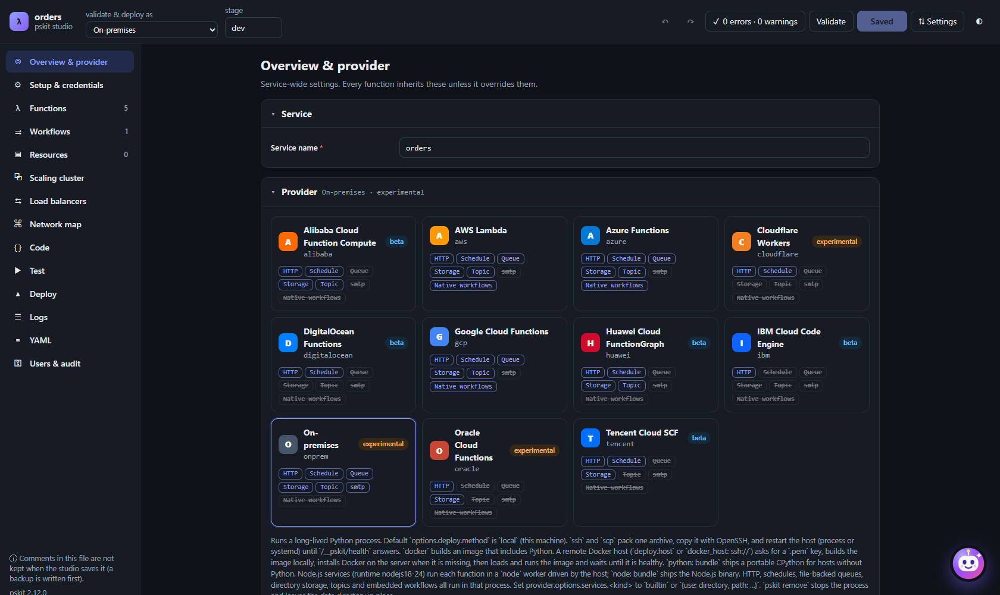

## Contents

**Start**

1. [Install and start studio](#1-install-and-start-studio)
2. [Choose who will use the project](#2-choose-who-will-use-the-project)
3. [Create the project](#3-create-the-project)
4. [Check your tools and credentials](#4-check-your-tools-and-credentials)
5. [Pick a cloud](#5-pick-a-cloud)

**Build**

6. [Create a function](#6-create-a-function)
7. [Add a trigger](#7-add-a-trigger)
8. [Write the handler code](#8-write-the-handler-code)
9. [Create a workflow](#9-create-a-workflow)
10. [Add a resource](#10-add-a-resource)
11. [Create a database in one click](#11-create-a-database-in-one-click)

**Run**

12. [Test a function](#12-test-a-function)
13. [Deploy](#13-deploy)
14. [Read the logs](#14-read-the-logs)
15. [Review pskit.yml](#15-review-pskityml)
16. [Ask Hana, the AI assistant](#16-ask-hana-the-ai-assistant)

**Your own servers**

17. [Save a server](#17-save-a-server)
18. [Create a scaling cluster](#18-create-a-scaling-cluster)
19. [Add a load balancer](#19-add-a-load-balancer)
20. [Read the network map](#20-read-the-network-map)

**Team**

21. [Work as a team](#21-work-as-a-team)

**Reference:** [Python and Node.js](#python-and-nodejs) · [Why](#why) · [Features](#features) · [Supported providers](#supported-providers) · [How it works](#how-it-works) · [Examples](#examples) · [Documentation](#documentation)

## One handler, every cloud

Handlers use one small, provider-neutral API (`Event`, `Context`, `Response`). Edit them on the **Code** page, or in your own editor.

**Python**

```python
# app/handlers.py
from py_serverless_kit import Event, Context, NotFound

def get_order(event: Event, ctx: Context):
    order = ORDERS.get(event.http.path_params["id"])
    if order is None:
        raise NotFound("no such order")      # -> HTTP 404 JSON on every cloud
    return order                              # -> HTTP 200 JSON
```

**Node.js (TypeScript or JavaScript)**

```ts
// src/handlers.ts
import { NotFound } from "pskit";
import type { Context, Event } from "pskit";

export async function getOrder(event: Event, ctx: Context) {
  const order = ORDERS.get(event.http!.pathParams.id);
  if (!order) throw new NotFound("no such order");   // -> HTTP 404 JSON on every cloud
  return order;                                       // -> HTTP 200 JSON
}
```

Studio saves your choices in a plain `pskit.yml`, which you can review on the **YAML** page and keep in git. Only `runtime` and the handler path differ between the two languages:

```yaml
service: orders
provider:
  name: aws             # <- pick gcp, azure, onprem, ... and redeploy. That's the migration.
  region: us-east-1
  runtime: python3.12   # or nodejs20
functions:
  get-order:
    handler: app.handlers.get_order     # Node.js: src.handlers.getOrder
    events:
      - http: GET /orders/{id}
```

---

# Build a project in studio

The screenshots below come from the real app, using a demo project.

## 1. Install and start studio

```bash
pip install py-serverless-kit
pskit studio
```

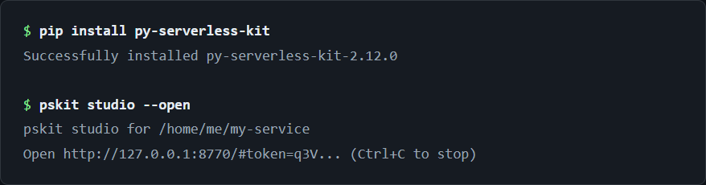

Open the link it prints. Everything else happens in the browser. Press **Ctrl+C** in the terminal to stop studio.

You need **Python 3.9 or newer** and **Terraform 1.5 or newer** (or OpenTofu). For Node.js projects you also need **Node.js 18 or newer and npm**. Step 4 checks all of this for you.

## 2. Choose who will use the project

The first start in a project asks this once.

- **Just me, on this computer:** no login, and nothing is encrypted.
- **A team, sharing through git:** an admin account, user permissions and an audit log, with secrets kept encrypted so they can be shared through git. See [step 21](#21-work-as-a-team).

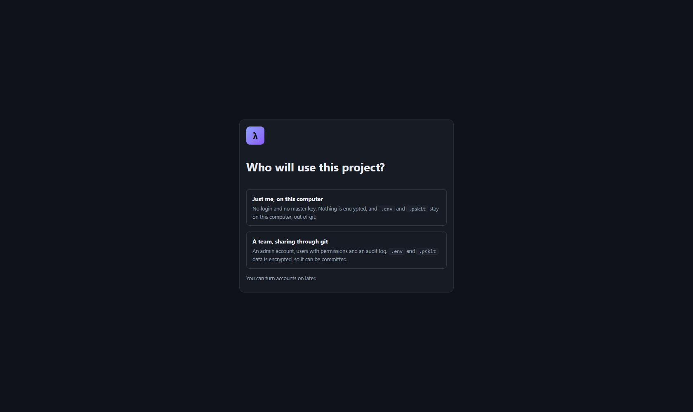

## 3. Create the project

In a folder with no project yet, studio opens **Create a pskit project**.

1. Enter the **Service name**.
2. Click a **Provider** card. Its chips show what that provider supports.
3. Choose the **Language**: **Python**, **JavaScript** or **TypeScript**.
4. Choose a **Template**: **HTTP API**, **Events**, **Workflow** or **Everything**.
5. Click **Create project**.

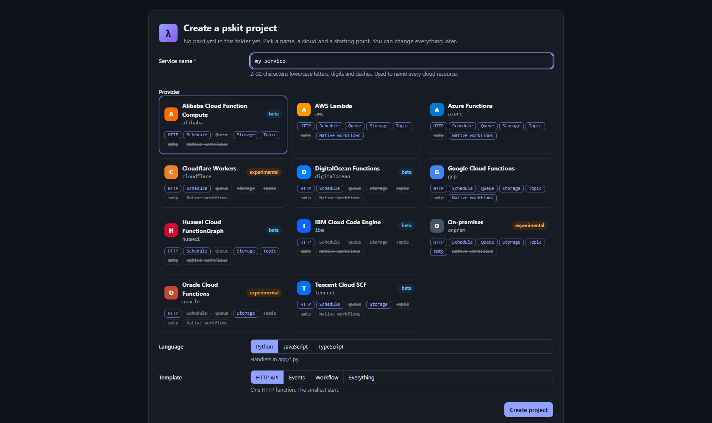

More: [New project guide](https://github.com/kavion-ai/py-serverless-kit/blob/main/docs/studio-guide/new-project.md).

## 4. Check your tools and credentials

Open **Setup & credentials**. It checks what this machine needs to deploy to the provider you picked, and shows how to fix what is missing. Then click **Check again**.

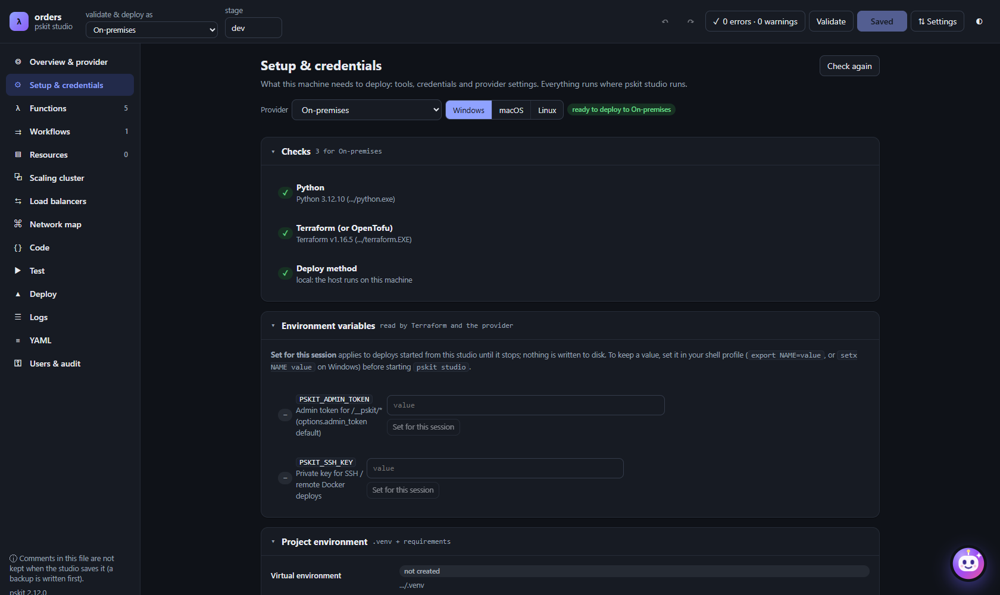

More: [Setup guide](https://github.com/kavion-ai/py-serverless-kit/blob/main/docs/studio-guide/setup.md).

## 5. Pick a cloud

Open **Overview & provider** and click a provider card. Set its region and options on the same page.


**To move to another cloud later**, pick it under **validate & deploy as** in the top bar and deploy again. Your handlers do not change. The red and green count next to it shows at once if something needs fixing for that cloud.

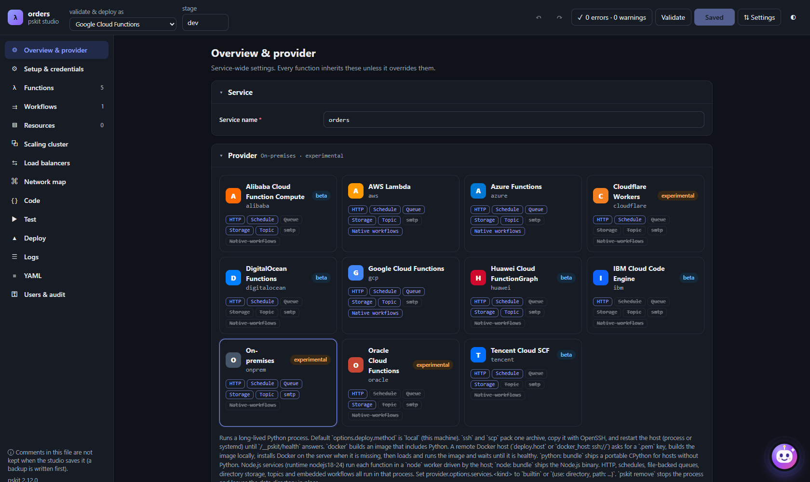

More: [Overview guide](https://github.com/kavion-ai/py-serverless-kit/blob/main/docs/studio-guide/overview.md).

## 6. Create a function

1. Open **Functions** and click **+ Create function**.
2. On **Basics**, enter the **Function name**. The **Handler** follows the name until you edit it.
3. Click **Next: Triggers**.

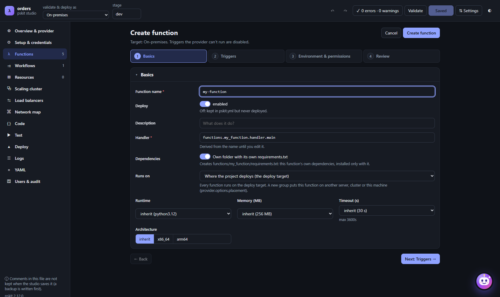

When you finish the wizard, the function appears in the table. Press **Save** in the top bar to write it to `pskit.yml`.

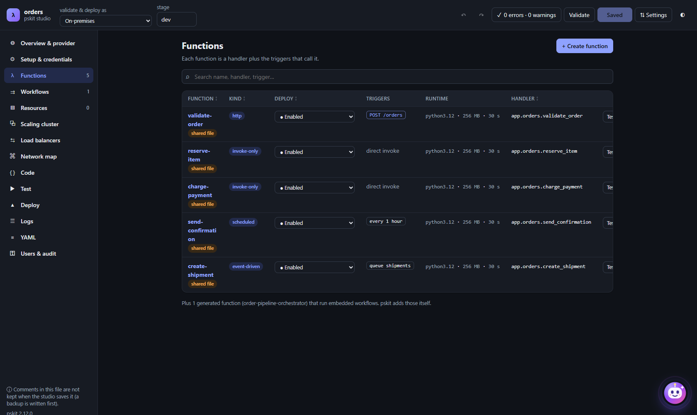

More: [Functions guide](https://github.com/kavion-ai/py-serverless-kit/blob/main/docs/studio-guide/functions.md).

## 7. Add a trigger

On the **Triggers** step, click what should call the function: **HTTP endpoint**, **Schedule**, **Queue**, **Storage**, **Topic** or **E-mail (SMTP)**. Then fill in its form. Triggers the provider can't run are disabled.

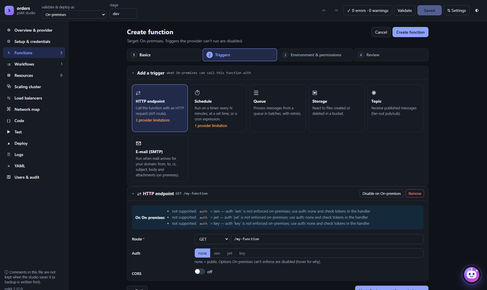

Next, set variables on **Environment & permissions**. **Review** shows exactly what changes in `pskit.yml`. Click **Create function**.

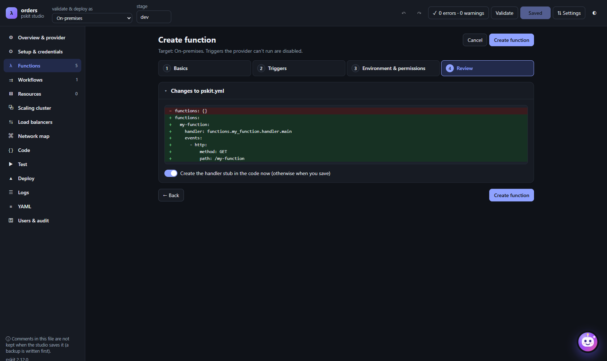

More: [Trigger forms](https://github.com/kavion-ai/py-serverless-kit/blob/main/docs/studio-guide/trigger-forms.md).

## 8. Write the handler code

Open **Code** to edit handlers in the built-in editor, or switch to **Full VS Code**. You can also use your own editor.

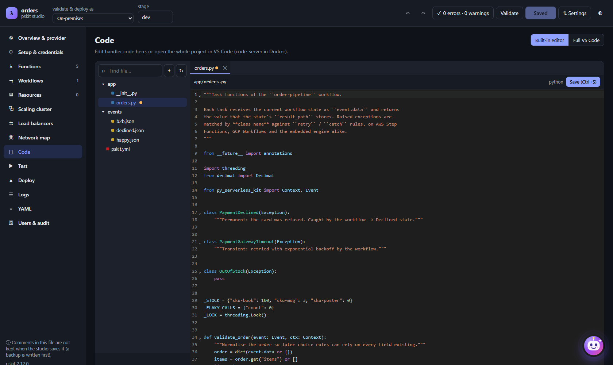

More: [Code guide](https://github.com/kavion-ai/py-serverless-kit/blob/main/docs/studio-guide/code.md).

## 9. Create a workflow

1. Open **Workflows** and click **+ Create workflow**.

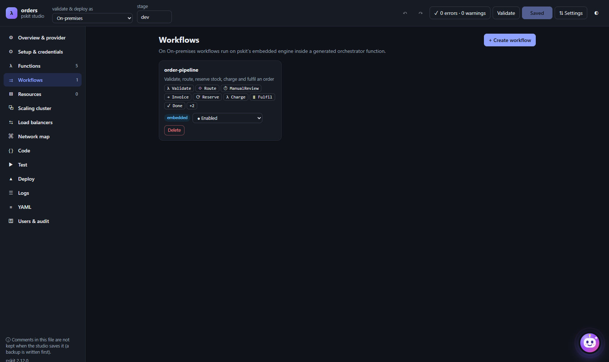

2. Enter the **Name** and click **Create**.

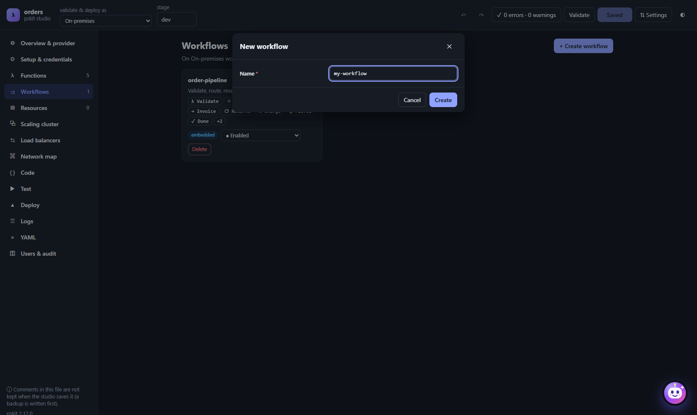

3. Add states from the palette: **task**, **choice**, **wait**, **pass**, **parallel**, **map**, **succeed** and **fail**. A new state is chained after the selected one.

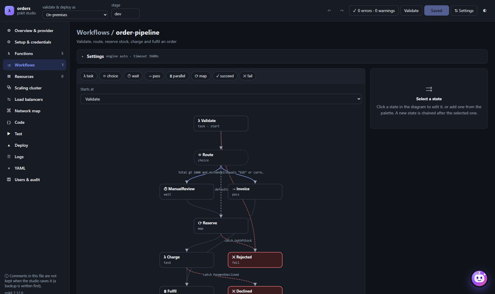

4. Click a state to edit it, including its function, next state, **Retry** and **Catch**. Then press **Save**.

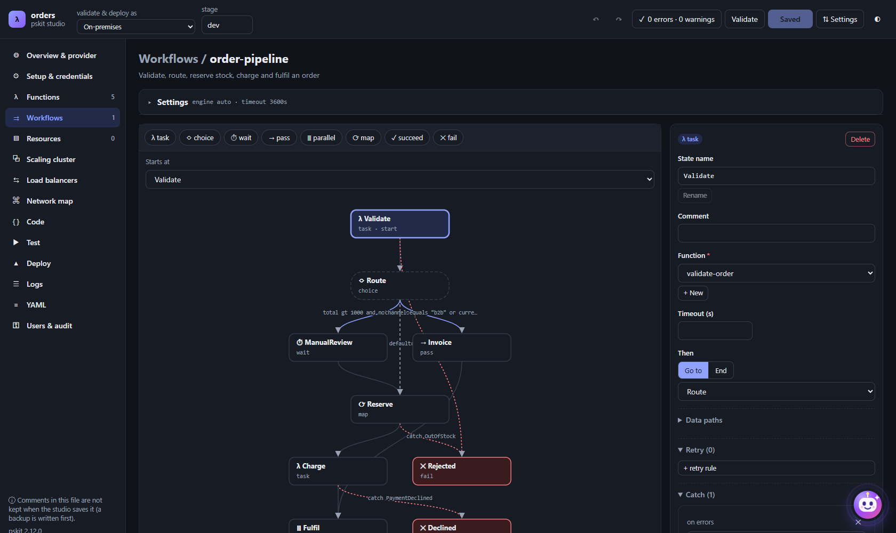

The same workflow becomes **AWS Step Functions** on AWS and **Google Cloud Workflows** on GCP. Other clouds run it with a built-in engine, and Azure can use Logic Apps.

More: [Workflows guide](https://github.com/kavion-ai/py-serverless-kit/blob/main/docs/studio-guide/workflows.md).

## 10. Add a resource

Use this for a bucket, queue, topic, database or any other service, created by pskit or one you already have.

1. Open **Resources** and click **+ Add resource**.
2. Enter the **Key**, and choose the **Type** and **Mode**.
3. Click **Add**, then press **Save**.

Handlers read it with `resource("key")` on every cloud.

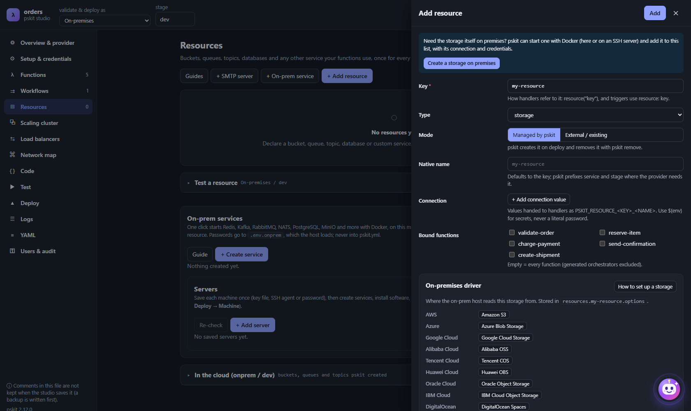

More: [Resources guide](https://github.com/kavion-ai/py-serverless-kit/blob/main/docs/studio-guide/resources.md).

## 11. Create a database in one click

For on-premises projects, studio can start the database for you with Docker, on this machine or on a saved server. The same works for queues, caches, buckets, secret managers and more: 44 services in all.

1. On **Resources**, click **+ Create service** and pick a card, such as **PostgreSQL**.

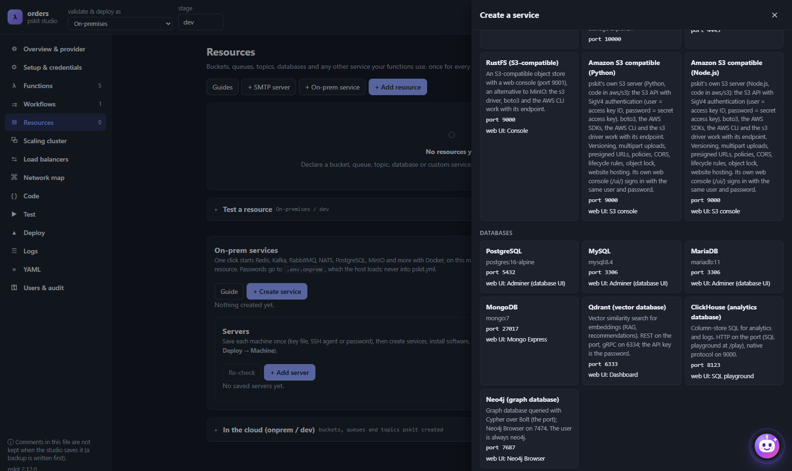

2. Check the **Resource key** and **Where** it runs. Leave **Password** empty to get a strong random one, kept out of `pskit.yml`.
3. Click **Create**.

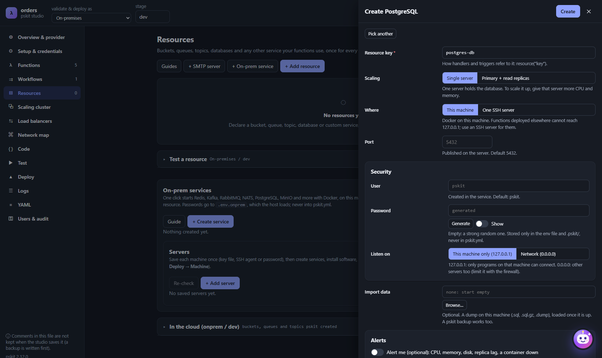

4. When it is created, press **Save**. The database is now a resource of the project, and its row has **How to use**, **Console**, **Terminal** and **Backup**.

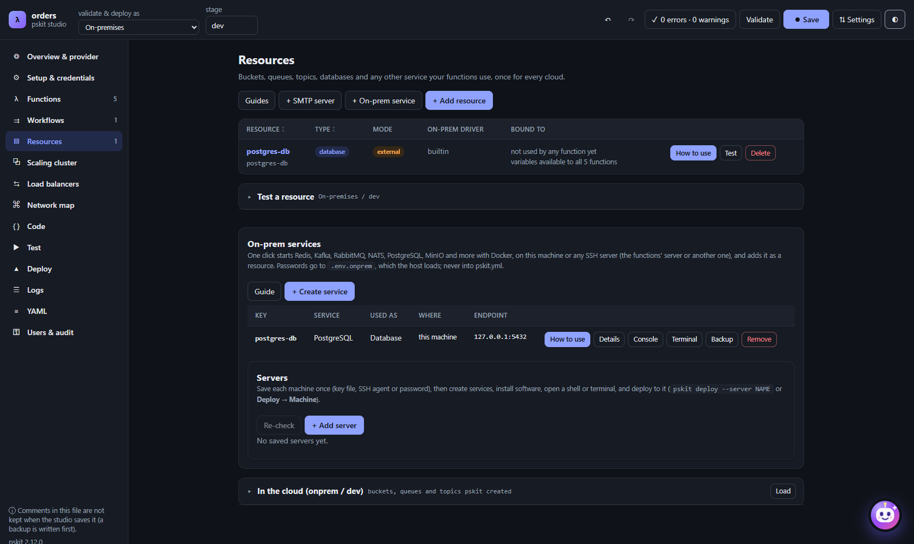

More: [On-prem services guide](https://github.com/kavion-ai/py-serverless-kit/blob/main/docs/studio-guide/onprem-services.md).

## 12. Test a function

1. Open **Test** and click a function.
2. Choose the event and edit the payload. Save events you use often.

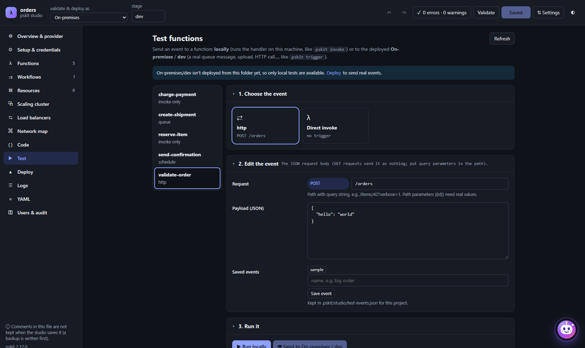

3. Click **Run locally**. It runs on your machine, with no cloud needed. Once deployed, you can also send a real event.

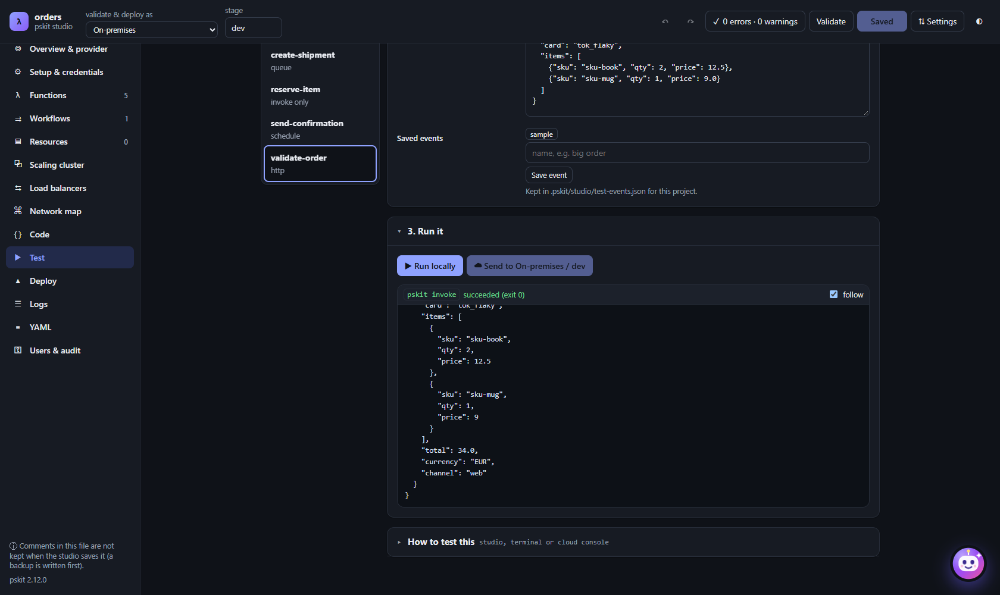

More: [Test guide](https://github.com/kavion-ai/py-serverless-kit/blob/main/docs/studio-guide/test.md).

## 13. Deploy

1. Pick the provider and stage in the top bar.
2. Open **Deploy** and click **Deploy**.

The same page has **Validate**, **Package**, **Plan**, **Info** and **Remove**. If your project uses something the target cloud can't support, studio tells you clearly instead of deploying something half-working.

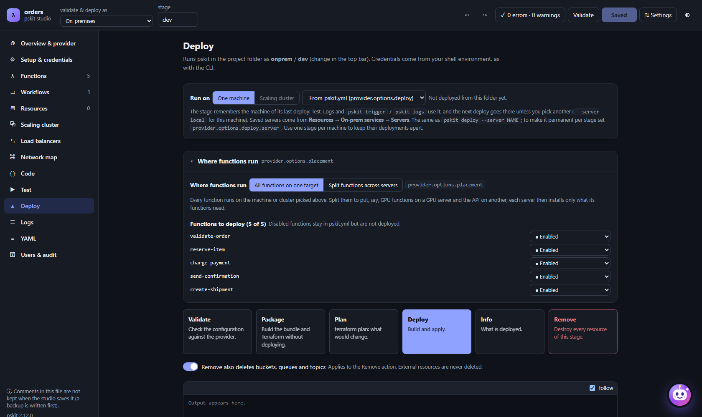

The steps update live until the deploy is done, and **Done** shows your endpoint.

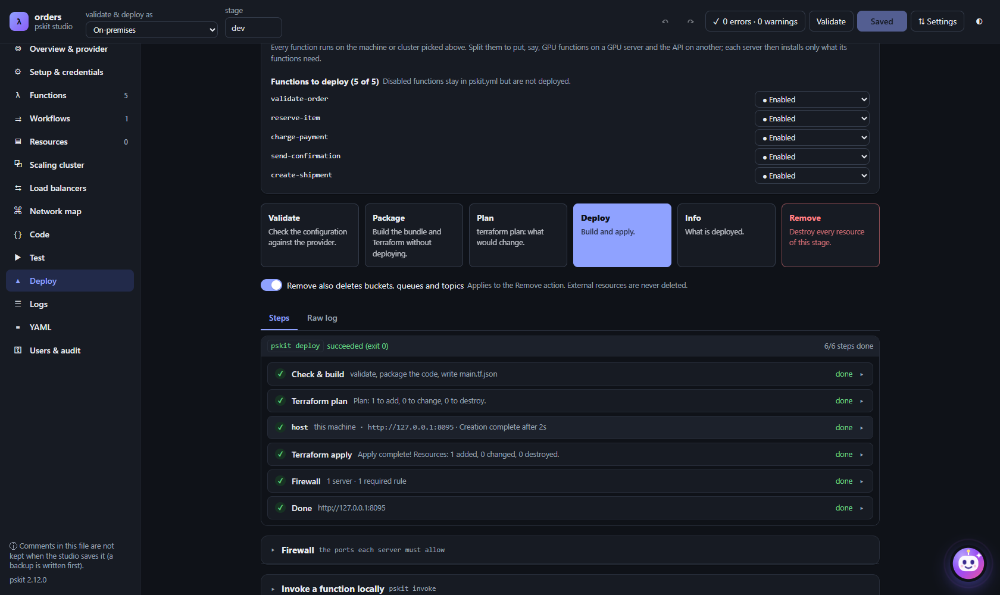

More: [Deploy guide](https://github.com/kavion-ai/py-serverless-kit/blob/main/docs/studio-guide/deploy.md).

## 14. Read the logs

Open **Logs** to follow your deployed functions live. Filter by level, function or source, or search the messages. This example shows a workflow whose payment step failed once, was retried and then succeeded.

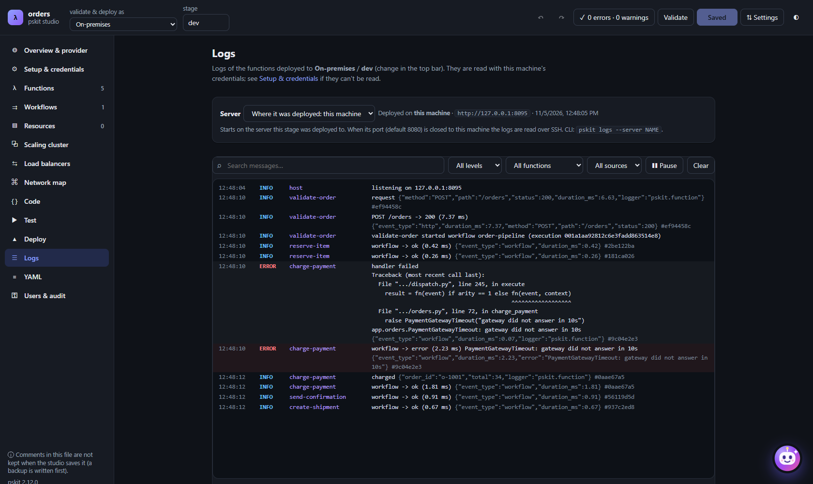

More: [Logs guide](https://github.com/kavion-ai/py-serverless-kit/blob/main/docs/studio-guide/logs.md).

## 15. Review pskit.yml

Everything you do in studio is saved in a plain `pskit.yml` that you can keep in git. Open **YAML** to preview it, compare it with the file on disk, or edit it directly.

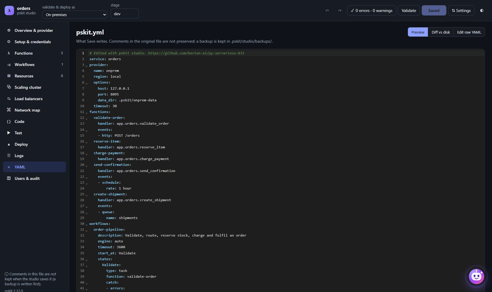

More: [YAML guide](https://github.com/kavion-ai/py-serverless-kit/blob/main/docs/studio-guide/yaml.md).

## 16. Ask Hana, the AI assistant

Hana answers questions about pskit and can change your project after you approve her plan. Her model runs on your machine or your server, so nothing you type is sent to a cloud.

1. Click the round avatar at the bottom right, or press **Ctrl+I**.
2. The first time, choose **Where should Hana run?** and click **Install & start**. The Docker image is about 4 GB.

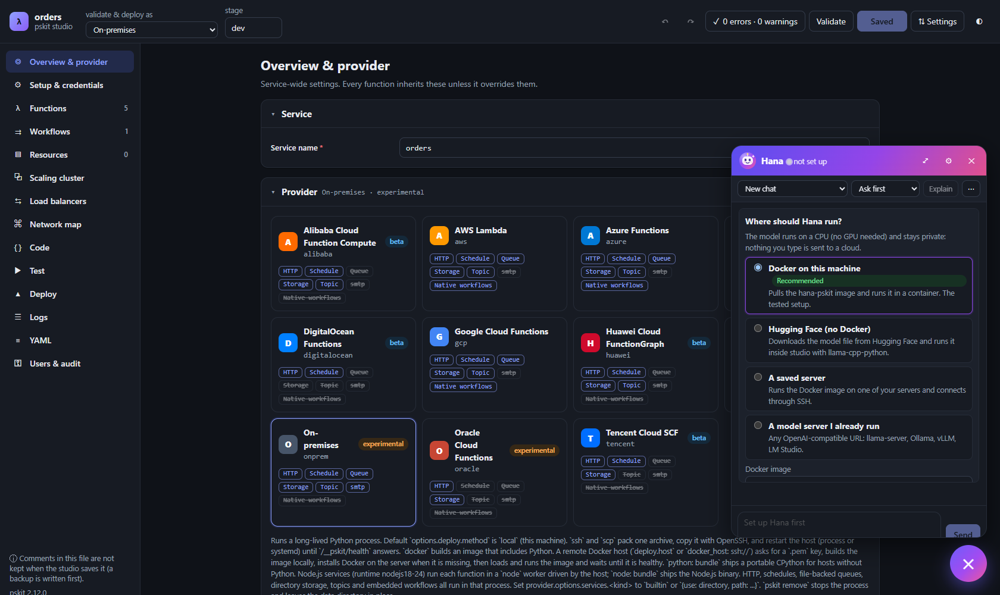

3. Ask your question. Hana can make mistakes, so check her answers.

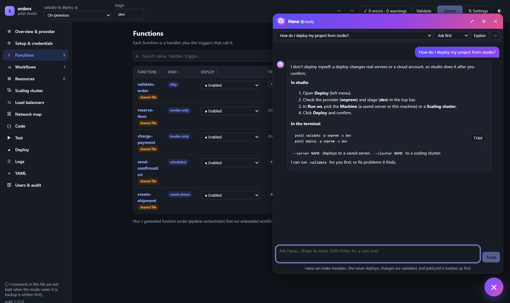

More: [Hana guide](https://github.com/kavion-ai/py-serverless-kit/blob/main/docs/studio-guide/hana.md).

---

# Your own servers

These steps are for projects using the **On-premises** provider.

## 17. Save a server

1. On **Resources**, under **Servers**, click **+ Add server**.
2. Enter a **Name**, the **Host** and the **User**, and choose how to **Log in with**.
3. Click **Save and test**.

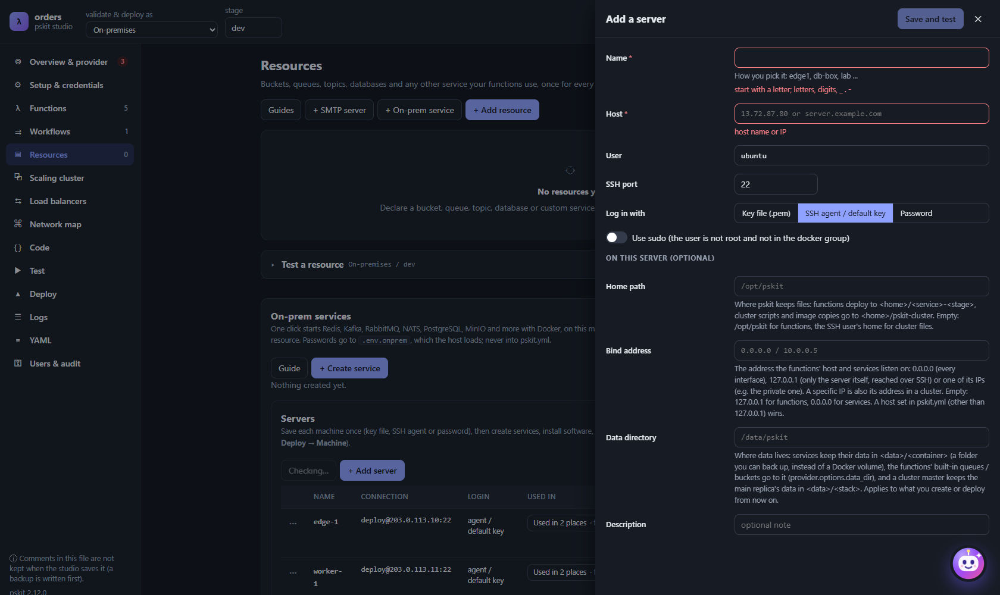

More: [Servers guide](https://github.com/kavion-ai/py-serverless-kit/blob/main/docs/studio-guide/servers.md).

## 18. Create a scaling cluster

Run your functions on several servers with Docker Swarm, Kubernetes (k3s) or Nomad.

1. Open **Scaling cluster** and click **+ New cluster**.
2. Enter the **Cluster name**, choose the **Orchestrator** and pick the **Master server**.
3. Click **Create**. pskit installs it over SSH.

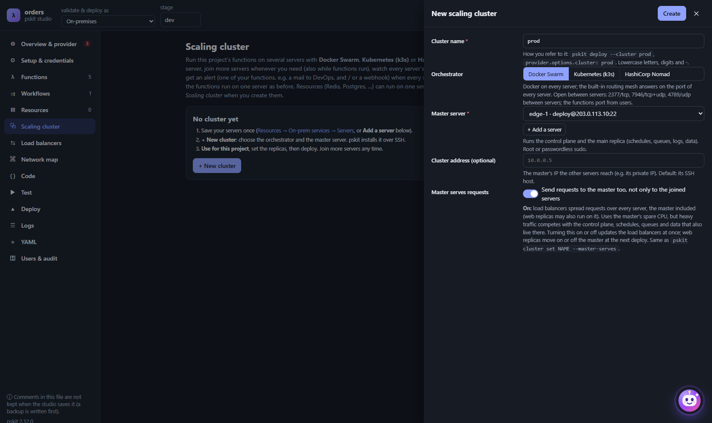

4. Click **+ Join server** to add more servers at any time.
5. Turn on **Deploy this project's functions to** your cluster, press **Save**, then deploy from the **Deploy** page.

Each server shows its CPU, memory and disk, and an alert can tell you when every server is full.

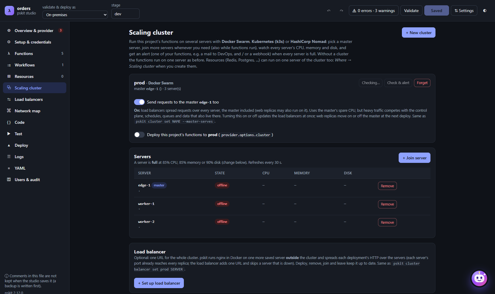

*The example servers in this picture are placeholders, so they show as offline. A live server shows its CPU, memory and disk.*

More: [Scaling cluster guide](https://github.com/kavion-ai/py-serverless-kit/blob/main/docs/studio-guide/cluster.md).

## 19. Add a load balancer

Give several projects and clusters one address, separated by path.

1. Open **Load balancers** and click **+ Create load balancer**.
2. Enter the **Name**, pick the **Server** and choose how it spreads requests. There are six algorithms, each explained on the form.
3. Click **Create**.

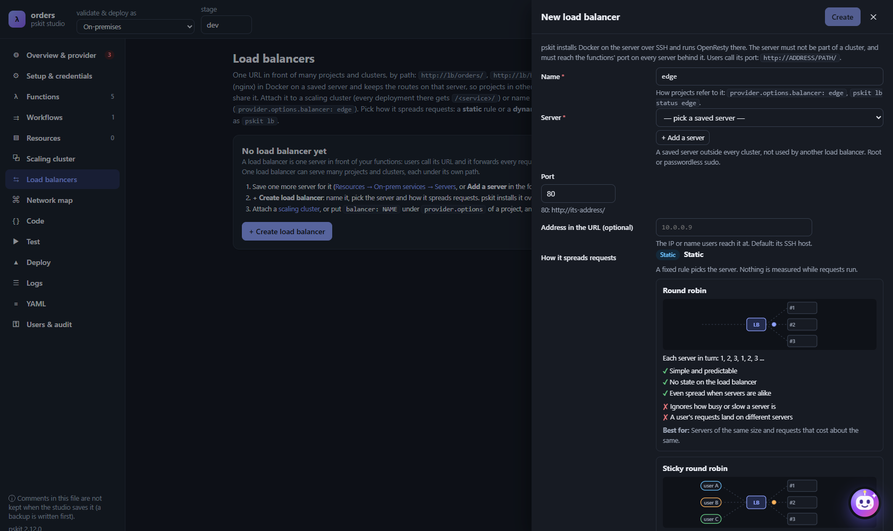

More: [Load balancers guide](https://github.com/kavion-ai/py-serverless-kit/blob/main/docs/studio-guide/load-balancers.md).

## 20. Read the network map

Open **Network map** to see every server and the connections it must accept and open, for deploys, clusters, load balancers and services.

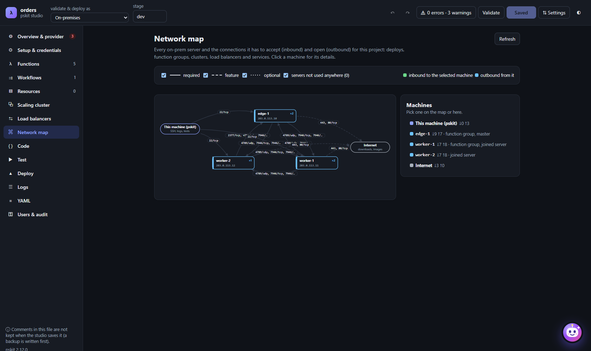

Click a machine to see each port it must allow, and why. The **Firewall** panel on the **Deploy** page lists the same rules with ready-made commands.

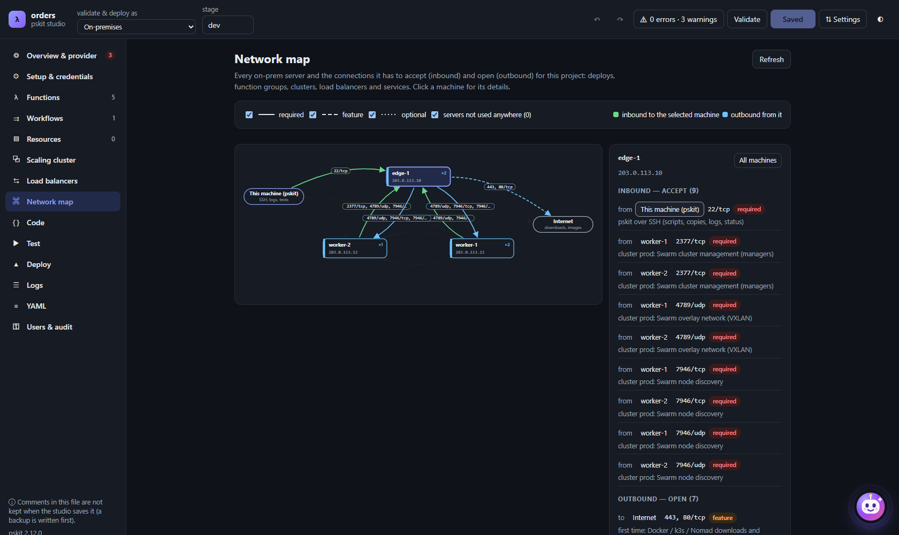

More: [Network map guide](https://github.com/kavion-ai/py-serverless-kit/blob/main/docs/studio-guide/network.md).

---

# Team

## 21. Work as a team

With **A team**, `.env` files and `.pskit` settings are encrypted (AES-256-GCM) into `.pskit-vault/`, which is safe to commit.

**The admin creates the account.** Choose a username and a password of at least 12 characters.

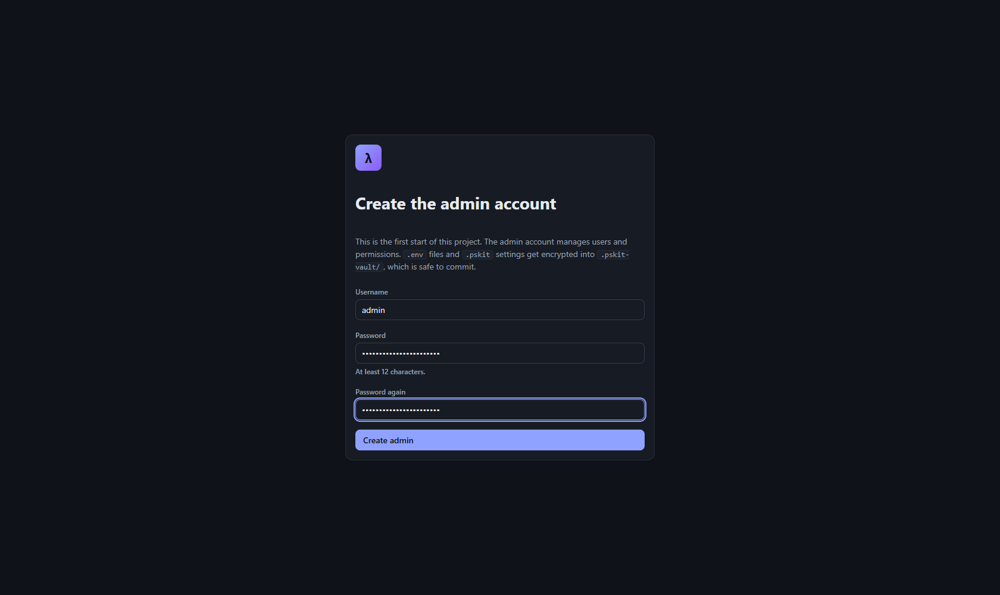

**Save the two keys.** They are shown only once.

- **Master key:** shared with the team and needed at every login. pskit does not save it, so keep it in a password manager.
- **Recovery code:** kept offline by the admin. With the master key, it sets a new admin password if all are lost.

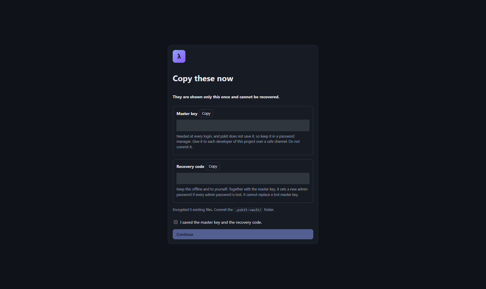

**Add your teammates.** Open **Users & audit > Users & permissions** and click **Add a user**. Start from the `viewer`, `developer` or `operator` preset and tick create, read, update and delete per feature. An account can decrypt only the data its permissions allow.

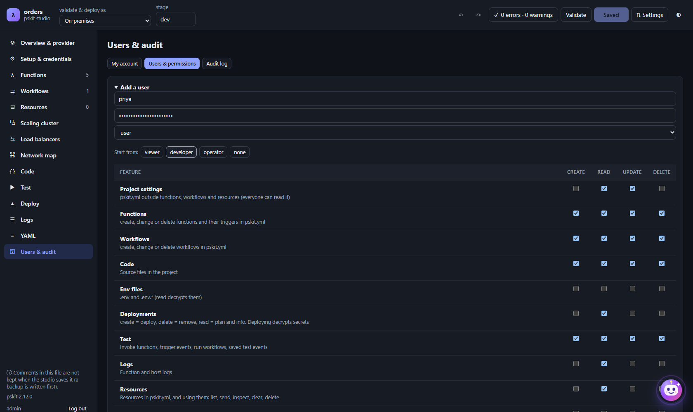

**Each teammate logs in** with the master key, their username and their password.

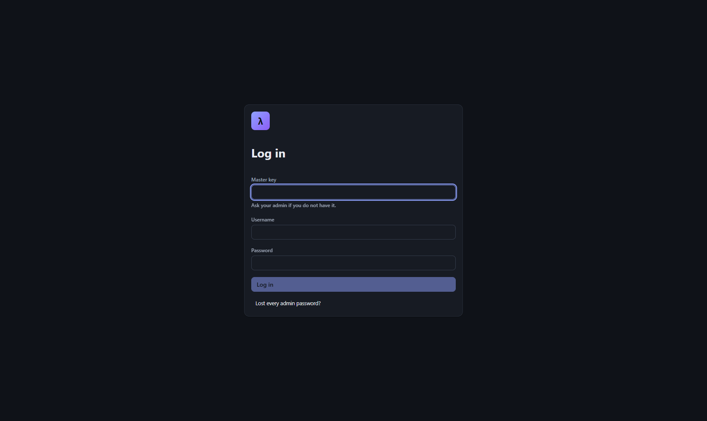

**See who did what** on the **Audit log** tab: every change, refused action, login and deploy.

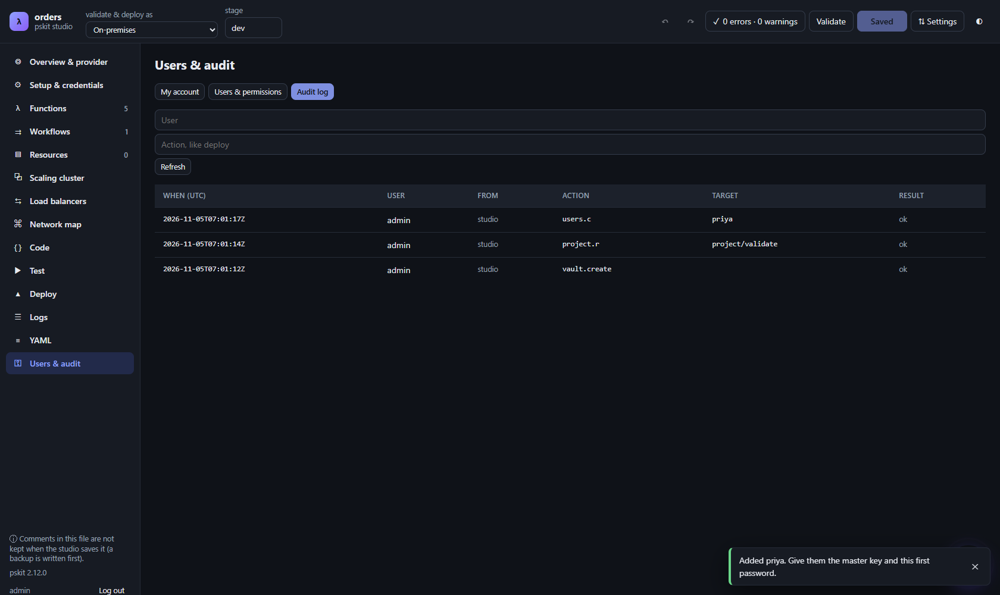

Permissions other than decrypting are enforced by pskit on each person's own computer, so your cloud credentials and git branch protection still protect production. Read the [team setup guide](https://github.com/kavion-ai/py-serverless-kit/blob/main/docs/studio-guide/accounts-and-team.md) and [what this protects against](https://github.com/kavion-ai/py-serverless-kit/blob/main/docs/security-vault.md#what-this-protects-against-and-what-it-does-not).

---

## Python and Node.js

Both languages get the same triggers, workflows, resources and studio pages.

| | Python | Node.js |
|---|---|---|
| **Runtimes** | `python3.9` to `python3.14` | `nodejs18`, `nodejs20`, `nodejs22`, `nodejs24` |
| **Languages** | Python | JavaScript, or TypeScript that pskit compiles for you |
| **Dependencies** | `requirements.txt` | `package.json`, bundled by pskit or the platform's build |
| **Handler** | `app.handlers.get_order` is `get_order` in `app/handlers.py` | `src.handlers.getOrder` is the `getOrder` export of `src/handlers.ts` |
| **Example** | [01-hello-http](https://github.com/kavion-ai/py-serverless-kit/tree/main/examples/01-hello-http) | [21-nodejs-typescript](https://github.com/kavion-ai/py-serverless-kit/tree/main/examples/21-nodejs-typescript) |

A service uses one language. To mix them, split the functions into two services that call each other over HTTP or a queue. Which versions you can use depends on the provider: see the [table below](#supported-providers). More: [Node.js and TypeScript](https://github.com/kavion-ai/py-serverless-kit/blob/main/docs/nodejs.md) and the [Handler API](https://github.com/kavion-ai/py-serverless-kit/blob/main/docs/handlers.md).

## Why

Teams that build on AWS Lambda and Step Functions end up with code full of API Gateway event parsing, SQS record loops and hand-written ASL. When the business needs another cloud, every function has to be rewritten. `py-serverless-kit` fixes this at each layer:

| Layer | Locked-in way | With pskit |
|---|---|---|
| Handler code | Parses `event["requestContext"]["http"]["method"]`, `Records[].body`, ... | Uses `event.http.method`, `event.records[].body`: the same on every cloud |
| Triggers / infra | SAM / CloudFormation / console clicks | One project in studio, rendered to Terraform for the target cloud |
| Workflows | Step Functions ASL | Portable state machine, compiled to Step Functions or Google Cloud Workflows, or run by the built-in engine elsewhere |
| Visibility | One console per cloud | One generated dashboard across all clouds and stages |

## Features

### Build

- **Triggers:** HTTP (path params, CORS, auth), schedules (rate/cron, translated into each cloud's cron dialect), queues, object storage, pub/sub topics, e-mail ([SMTP](https://github.com/kavion-ai/py-serverless-kit/blob/main/docs/smtp/README.md), on premises) and direct function-to-function `invoke()`.
- **Workflows:** task / choice / wait / pass / parallel / map / succeed / fail with retry and catch. The dashboard lists runs, and lets you follow and cancel them.
- **Resources:** buckets, queues, topics, databases, caches or any service, created by pskit or attached as existing ones. Handlers read them with `resource("name")` on every cloud. See [using resources from code](https://github.com/kavion-ai/py-serverless-kit/blob/main/docs/resource-usage.md) and the [per-cloud guides](https://github.com/kavion-ai/py-serverless-kit/blob/main/docs/resource-guides/README.md).
- **Editing:** a built-in code editor or full VS Code in Docker, a raw YAML page with a diff, and undo and redo.
- **[Hana, the AI assistant](https://github.com/kavion-ai/py-serverless-kit/blob/main/docs/assistant.md):** a chat in studio that answers questions and changes your project with your approval. The model runs on your machine or server, so nothing you type is sent to a cloud.

### Deploy

- **10 clouds and your own servers:** AWS Lambda, Azure Functions, Google Cloud Functions (gen2), Alibaba Function Compute, Oracle Functions, IBM Code Engine, DigitalOcean Functions, Tencent SCF, Huawei FunctionGraph, Cloudflare Workers, and on premises.
- **Terraform underneath:** real, reviewable `main.tf.json`, any backend (S3, GCS, azurerm, ...), works with OpenTofu.
- **Stages:** switch `dev`, `prod` or any stage in the top bar, with settings per stage and per provider.
- **Production details:** deterministic artifacts (no redeploy when nothing changed), partial batch failures (`BatchResult`), structured JSON logs, consistent HTTP error mapping and stack traces hidden from clients.
- **[Dashboard](https://github.com/kavion-ai/py-serverless-kit/blob/main/docs/dashboard.md):** a generated page listing every deployment, function, trigger, endpoint, console link, workflow and resource.

### Run on your own servers

- **Deploy methods:** a process on this machine, SSH/SCP onto a saved server, or Docker. pskit can install Docker on a server that lacks it and bring a bundled CPython when the server has no Python. See [on premises](https://github.com/kavion-ai/py-serverless-kit/blob/main/docs/onprem/README.md).
- **[Scaling clusters](https://github.com/kavion-ai/py-serverless-kit/blob/main/docs/studio-guide/cluster.md):** Docker Swarm, Kubernetes (k3s) or Nomad over a master and joined servers, with live capacity monitoring and an alert when every server is full.
- **[Function groups on several servers](https://github.com/kavion-ai/py-serverless-kit/blob/main/docs/studio-guide/placement.md):** each function in its own folder with its own dependencies, on servers that call each other and run workflows across machines.
- **[Load balancers](https://github.com/kavion-ai/py-serverless-kit/blob/main/docs/studio-guide/load-balancers.md):** six algorithms, with one balancer serving several projects and clusters by path.
- **[On-prem services](https://github.com/kavion-ai/py-serverless-kit/blob/main/docs/studio-guide/onprem-services.md):** a catalog of 44 queues, databases, buckets, caches, secret managers and tools, started as Docker containers and added to your project.
- **[AWS-compatible servers](https://github.com/kavion-ai/py-serverless-kit/blob/main/docs/onprem/aws-compatible/README.md):** S3 and Secrets Manager servers, each in Python and Node.js, so AWS SDK code runs on your machines with only an endpoint change.
- **[Network map](https://github.com/kavion-ai/py-serverless-kit/blob/main/docs/studio-guide/network.md) and [Firewall panel](https://github.com/kavion-ai/py-serverless-kit/blob/main/docs/studio-guide/firewall.md):** which ports each server must open.
- **[Client library and HTTP API](https://github.com/kavion-ai/py-serverless-kit/blob/main/docs/client.md):** call an on-prem host's queues, buckets, topics and functions from any Python or Node.js program, or over HTTP.

## Supported providers

| Provider | Tier | HTTP | Schedule | Queue | Storage | Topic | Workflows | Python | Node.js |
|---|---|:-:|:-:|:-:|:-:|:-:|---|---|---|
| AWS Lambda | stable | ✅ | ✅ | ✅ SQS | ✅ S3 | ✅ SNS | native (Step Functions) | 3.9–3.13 | 18, 20, 22 |
| Google Cloud Functions | stable | ✅ | ✅ | ✅ Pub/Sub | ✅ GCS | ✅ Pub/Sub | native (Cloud Workflows) | 3.9–3.13 | 18, 20, 22 |
| Azure Functions | stable | ✅ | ✅ | ✅ Storage Queue | ✅ Blob | ✅ Service Bus | embedded, or Logic Apps | 3.9–3.12 | 18, 20, 22 |
| Alibaba Function Compute | beta | ✅ | ✅ | – | ✅ OSS | ✅ MNS | embedded | 3.9, 3.10, 3.12 | 18, 20 |
| Huawei FunctionGraph | beta | ✅ | ✅ | – | ✅ OBS | ✅ SMN | embedded | 3.9, 3.10, 3.12 | 18 |
| Tencent SCF | beta | ✅ | ✅ | – | ✅ COS | – | embedded | 3.9, 3.10 | 18 |
| DigitalOcean Functions | beta | ✅ | ✅ | – | – | – | embedded | 3.9, 3.11 | 18 |
| IBM Code Engine | beta | ✅ | – | – | – | – | embedded | 3.11 | 18, 20 |
| Oracle Cloud Functions | experimental | ✅ | – | – | ✅ | – | embedded | 3.9, 3.11 | 18, 20 |
| Cloudflare Workers | experimental | ✅ | ✅ | – | – | – | embedded | 3.11–3.13 | 18, 20, 22 |
| On-premises | experimental | ✅ | ✅ | ✅ files | ✅ directory | ✅ files | embedded (local, SSH, Docker or cluster) | 3.9–3.14 | 18–24 |

On premises, queues can also live in Redis or other drivers, storage in MinIO or any S3-compatible store, and functions can be triggered by e-mail.

> **Maturity, honestly stated:** the Terraform generated for every provider is checked with `terraform validate` against the real provider plugins (in CI, too). The *stable* providers cover the most surface area. *beta* and *experimental* providers follow vendor docs for event payloads that `validate` can't check, so try them on a non-production account first. See [docs/providers.md](https://github.com/kavion-ai/py-serverless-kit/blob/main/docs/providers.md) for each provider's details and limits.

## How it works

**At deploy time**, your project becomes Terraform:

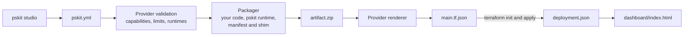

**At run time**, the same handler answers on every cloud:

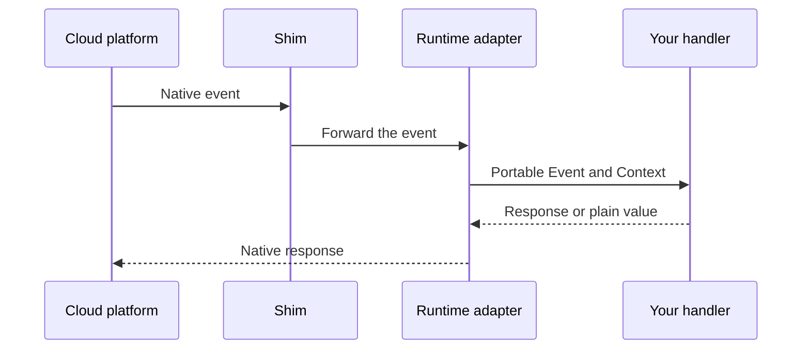

More: [docs/architecture.md](https://github.com/kavion-ai/py-serverless-kit/blob/main/docs/architecture.md).

## Examples

Twenty-one runnable examples live in [`examples/`](https://github.com/kavion-ai/py-serverless-kit/tree/main/examples/). They are tested in CI. Start `pskit studio` in any of these folders to open it.

| | |
|---|---|
| [01-hello-http](https://github.com/kavion-ai/py-serverless-kit/tree/main/examples/01-hello-http) | Minimal HTTP function |
| [02-rest-api](https://github.com/kavion-ai/py-serverless-kit/tree/main/examples/02-rest-api) | CRUD, path params, validation errors, CORS, cookies, binary, JWT |
| [03-scheduled-jobs](https://github.com/kavion-ai/py-serverless-kit/tree/main/examples/03-scheduled-jobs) | rate/cron schedules with input and time zones |
| [04-queue-worker](https://github.com/kavion-ai/py-serverless-kit/tree/main/examples/04-queue-worker) | Queue consumer, partial batch failures, dead-letter queue |
| [05-storage-events](https://github.com/kavion-ai/py-serverless-kit/tree/main/examples/05-storage-events) | Object created/deleted with filters |
| [06-pubsub-topic](https://github.com/kavion-ai/py-serverless-kit/tree/main/examples/06-pubsub-topic) | Topic fan-out and filters |
| [07-workflow-orders](https://github.com/kavion-ai/py-serverless-kit/tree/main/examples/07-workflow-orders) | Every workflow state type, retry/catch |
| [08-multi-cloud](https://github.com/kavion-ai/py-serverless-kit/tree/main/examples/08-multi-cloud) | Same code, all 11 providers |
| [09-function-invoke](https://github.com/kavion-ai/py-serverless-kit/tree/main/examples/09-function-invoke) | Function-to-function `invoke()` |
| [10-stages-and-config](https://github.com/kavion-ai/py-serverless-kit/tree/main/examples/10-stages-and-config) | Stages, variables, secrets |
| [11-custom-terraform](https://github.com/kavion-ai/py-serverless-kit/tree/main/examples/11-custom-terraform) | `terraform.extra`, `${tf:...}`, remote state, hooks |
| [12-async-and-context](https://github.com/kavion-ai/py-serverless-kit/tree/main/examples/12-async-and-context) | async handlers, logging, deadlines |
| [13-migrate-from-aws-lambda](https://github.com/kavion-ai/py-serverless-kit/tree/main/examples/13-migrate-from-aws-lambda) | Before/after migration of Lambda + Step Functions |
| [14-testing](https://github.com/kavion-ai/py-serverless-kit/tree/main/examples/14-testing) | Unit-testing handlers and workflows with pytest |
| [15-ci-cd-deploy](https://github.com/kavion-ai/py-serverless-kit/tree/main/examples/15-ci-cd-deploy) | GitHub Actions deploys per stage |
| [16-on-premises](https://github.com/kavion-ai/py-serverless-kit/tree/main/examples/16-on-premises) | HTTP, schedule, queue, storage, topic and a workflow on one machine |
| [17-on-premises-remote](https://github.com/kavion-ai/py-serverless-kit/tree/main/examples/17-on-premises-remote) | SSH/SCP or Docker onto a server |
| [18-resources](https://github.com/kavion-ai/py-serverless-kit/tree/main/examples/18-resources) | Managed and external resources, bindings, Redis/MinIO on premises |
| [19-custom-drivers](https://github.com/kavion-ai/py-serverless-kit/tree/main/examples/19-custom-drivers) | Your own on-prem queue/storage driver class; RabbitMQ and Kafka templates |
| [20-onprem-external-clouds](https://github.com/kavion-ai/py-serverless-kit/tree/main/examples/20-onprem-external-clouds) | On-prem host watching queues and buckets in AWS, Azure, GCP, Alibaba, Cloudflare and MinIO |
| [21-nodejs-typescript](https://github.com/kavion-ai/py-serverless-kit/tree/main/examples/21-nodejs-typescript) | Node.js and TypeScript: HTTP routes, a queue worker, a schedule and a workflow |

## Documentation

**Start at the [documentation home](https://github.com/kavion-ai/py-serverless-kit/blob/main/docs/README.md)**, which lists every guide. The most used pages:

| | |
|---|---|
| [Studio guide](https://github.com/kavion-ai/py-serverless-kit/blob/main/docs/studio-guide/README.md) | Every page and button of the web UI |
| [Studio end to end](https://github.com/kavion-ai/py-serverless-kit/blob/main/docs/guide/end-to-end-studio.md) | One full application, click by click |
| [Accounts and team setup](https://github.com/kavion-ai/py-serverless-kit/blob/main/docs/studio-guide/accounts-and-team.md) | Just me or a team, master key, recovery code, user permissions |
| [Handler API](https://github.com/kavion-ai/py-serverless-kit/blob/main/docs/handlers.md) | `Event`, `Context`, `Response`, errors, `BatchResult`, `invoke()` |
| [Node.js and TypeScript](https://github.com/kavion-ai/py-serverless-kit/blob/main/docs/nodejs.md) | JavaScript and TypeScript handlers, runtimes per provider, npm dependencies |
| [Events](https://github.com/kavion-ai/py-serverless-kit/blob/main/docs/events.md) | Every trigger, with a per-provider matrix |
| [Workflows](https://github.com/kavion-ai/py-serverless-kit/blob/main/docs/workflows.md) | State machine reference, engines, limitations |
| [Resources](https://github.com/kavion-ai/py-serverless-kit/blob/main/docs/resources.md) | Storage, queues, topics, databases, external services |
| [Providers](https://github.com/kavion-ai/py-serverless-kit/blob/main/docs/providers.md) | Options, credentials, resources and limits per cloud |
| [On premises](https://github.com/kavion-ai/py-serverless-kit/blob/main/docs/onprem/README.md) | Servers, services, scaling, load balancers, firewall |
| [Migrating from AWS](https://github.com/kavion-ai/py-serverless-kit/blob/main/docs/migrating-from-aws.md) | Lambda + Step Functions → pskit |
| [Troubleshooting](https://github.com/kavion-ai/py-serverless-kit/blob/main/docs/troubleshooting.md) | Common errors and fixes |

Prefer a terminal or CI? pskit also has a full command line: see the [CLI reference](https://github.com/kavion-ai/py-serverless-kit/blob/main/docs/cli.md).

## Contributing

- Contributor guide: [deploy_docs/CONTRIBUTING.md](https://github.com/kavion-ai/py-serverless-kit/blob/main/deploy_docs/CONTRIBUTING.md)
- Security policy: [SECURITY.md](https://github.com/kavion-ai/py-serverless-kit/blob/main/SECURITY.md)

## Author

Created and maintained by **Asif Khan @ [Kavion.ai](https://kavion.ai)**.

Source code, issues and releases: <https://github.com/kavion-ai/py-serverless-kit>

## License

MIT, see [LICENSE](https://github.com/kavion-ai/py-serverless-kit/blob/main/LICENSE).
