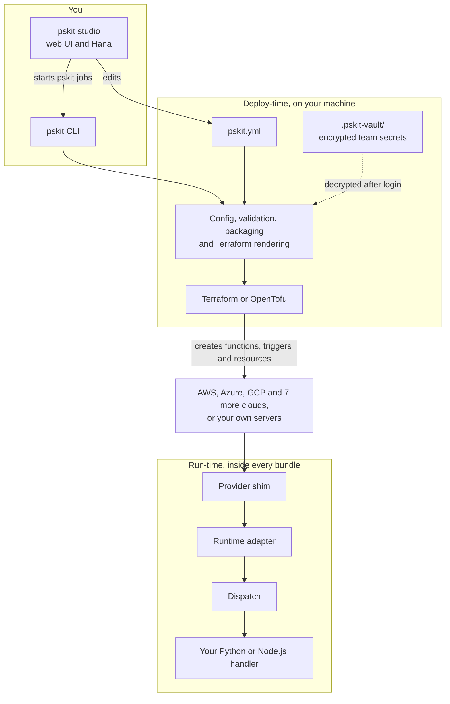
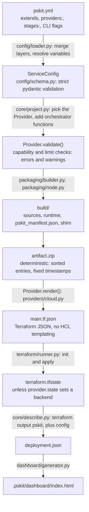
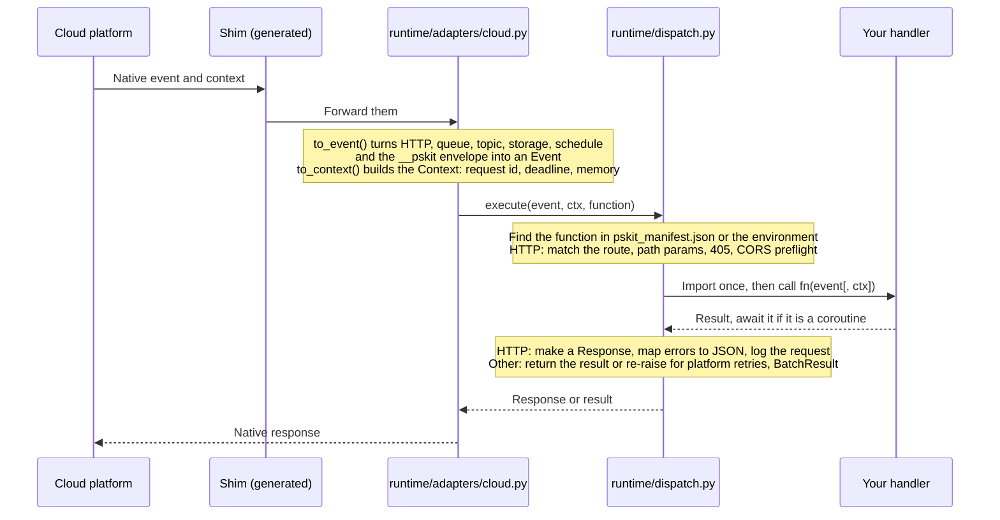
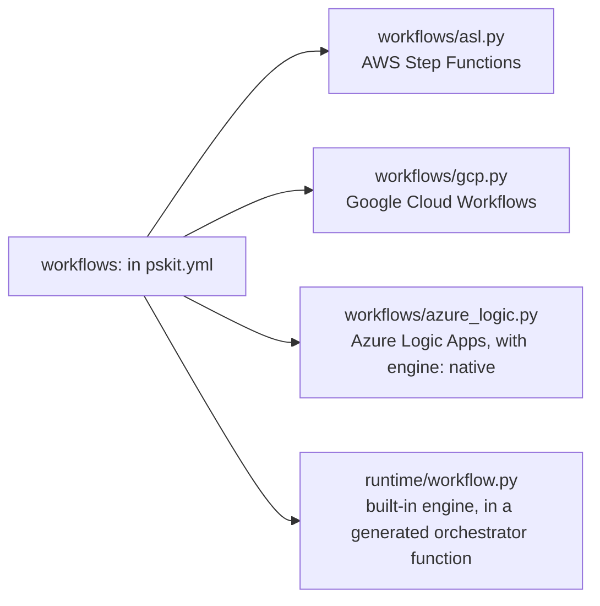
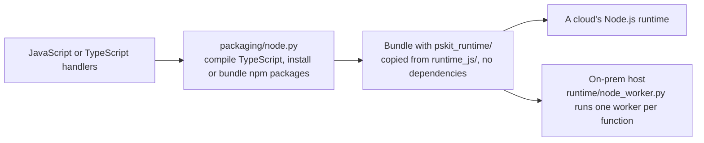
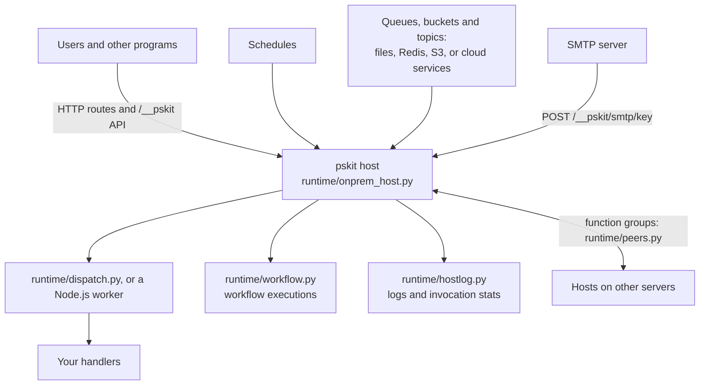
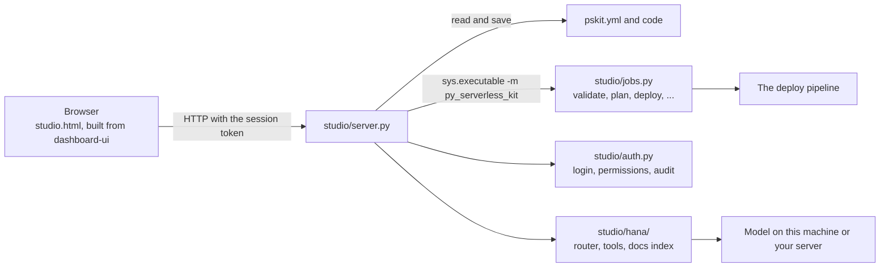
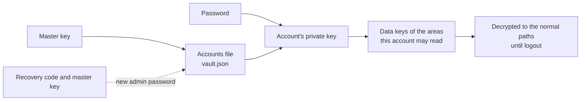

# Architecture

pskit has two halves:

- **Deploy-time** (the `pskit` CLI and `pskit studio`): turns `pskit.yml` into a deterministic zip plus Terraform JSON, and runs Terraform.
- **Run-time** (`py_serverless_kit.runtime`, or `runtime_js` for Node.js): a package with no third-party dependencies, copied into every bundle. It translates each cloud's native events into one portable model and calls your handler.

## Overview



## Deploy pipeline



Key properties:

- **Terraform JSON, not HCL.** The generator builds Python dicts, so there's no quoting or templating to get wrong. User strings are escaped (`${` → `$${`) unless written as `${tf:...}`.
- **Reproducible artifacts.** The zip is byte-identical for identical inputs. Unchanged code means an unchanged hash and no redeploy.
- **One directory per provider and stage.** Each has its own Terraform workspace and state, so `aws-dev` and `gcp-prod` never interfere.
- **Every provider emits a `pskit` output** with the shape `{functions: {name: {id, arn?, url?, base_url?, console?}}, workflows: {...}, endpoint}`. `pskit info` and the dashboard use only this output, which keeps them provider-agnostic.

Everything from `build/` to `deployment.json` lives in `.pskit/<provider>-<stage>/`.

## Bundle layout

```
artifact.zip
├── app/...                       your code (package.include/exclude + default excludes)
├── py_serverless_kit/            __init__.py, _version.py, runtime/  (no CLI, no pydantic/yaml/click)
│                                 runtime/ includes executions.py, hostlog.py, resources.py, drivers/ (redis, s3)
├── pskit_manifest.json           functions -> handler, routes, CORS, timeout, physical names; embedded workflows
├── <shim>                        pskit_entry.py (aws) · main.py (gcp) · function_app.py + host.json (azure)
│                                 index.py (alibaba/tencent/huawei) · __main__.py (ibm/do)
│                                 func.py + func.yaml + Dockerfile (oracle) · generated worker module (cloudflare)
│                                 onprem_handler.py (onprem; the host is started beside the zip)
└── dependencies or requirements.txt
```

On-premises also writes `.pskit/onprem-<stage>/onprem_app/` (`pskit_host.json`, `onprem_ctl.py`, `onprem_deploy.py`, `pskit-run.sh` for SSH, the staged bundle, and a Dockerfile or systemd unit when those methods are selected). Terraform `local-exec` runs `onprem_deploy.py apply`. Local starts the host on this machine. SSH and `scp` pack `release.tar.gz`, copy it with the optional `.pem`, extract it on the server, restart the process or the systemd unit, and wait for `/__pskit/health`. Docker builds an image on this machine. A remote Docker target installs Docker on the server when it is missing, copies the image with the `.pem`, and waits until the container is healthy.

At run time the host keeps its state under `data_dir`: `queues/`, `buckets/`, `topics/` (builtin services), `executions/<id>.json` (workflow runs), `logs/host.jsonl` (rotated at 10 MiB), `schedule-state.json` and `storage-snapshot.json`.

## Runtime flow



**The `__pskit` envelope.** Payloads that pskit itself produces are wrapped as `{"__pskit": "<schedule|workflow|invoke>", "data": ...}`. These are schedule inputs, workflow task inputs and `invoke()` calls. Because the adapter can recognise the envelope, the handler sees the right `event.type` even on clouds where everything arrives as HTTP (GCP, IBM, DigitalOcean, Cloudflare, Oracle). On those clouds, failures come back as `500 {"errorType", "cause"}` so native workflows can match errors by exception name.

**Embedded workflows.** On clouds without a native engine, `core/project.py` adds a `<workflow>-orchestrator` function whose handler is `py_serverless_kit.runtime.workflow.orchestrate`. It runs the state machine from the manifest and calls task handlers in-process through the same dispatcher. Every run gets an `execution_id`. Inside the on-premises host, `runtime/executions.py` (an `Executor` with a file-backed store) runs workflows in background threads, records status, current state and history in `<data_dir>/executions/<id>.json`, and supports cancel. On a cloud function the run stays synchronous and only the id is returned. `core/executions.py` gives the CLI and dashboard one interface over the host, AWS Step Functions (boto3) and Google Cloud Workflows.

**Resources.** `resources:` entries become `PSKIT_RESOURCE_<KEY>_*` environment variables (`ServiceConfig.binding_environment`, plus provider-known ARNs/URLs/ids), and `runtime/resources.py` reads them back. On premises, an event's `driver` binding makes the host's `Broker` use `runtime/drivers/redis.py` (queues) or `runtime/drivers/s3.py` (storage) instead of directories.

**On-premises observability.** `runtime/hostlog.py` captures logging, stdout/stderr, one entry per invocation, and host notes into a ring buffer plus `<data_dir>/logs/host.jsonl`, tagged per thread with the current function and request id. The host serves it at `/__pskit/logs`, with counters at `/__pskit/stats`. `pskit logs` and `pskit dashboard --serve` (`dashboard/server.py`) read those endpoints through `core/onprem_control.py`, which keeps the admin token server-side. `core/cloud_logs.py` puts one interface (query, streams, delete) over the host and the cloud log services (CloudWatch Logs, Cloud Logging, Log Analytics) so the CLI, dashboard and studio share it.

## Workflow engines

The same `workflows:` definition runs on the engine of the target:



## Node.js services

A service is either Python or Node.js, chosen by `provider.runtime`. The config, validation and Terraform steps are the
same. Only the packaging and the runtime differ:



`pskit_manifest.json` is the same as for Python. `runtime_js/` has its own `dispatch.js`, `workflow.js` and `adapters/`.

## On-premises host

On premises there is no cloud platform, so the bundle runs under a long-lived host process, `runtime/onprem_host.py`. It
is started on this machine, over SSH, in Docker or on a scaling cluster.



## Studio and Hana

`pskit studio` is a local web server. Every call needs the token printed at start, and it edits the same `pskit.yml` the
CLI uses.



## Accounts and the vault

In a team project, `.env` files and `.pskit` settings are stored encrypted in `.pskit-vault/`, which is committed. Each
step of a login needs the one before it, so no single secret opens the data. Details:
[Accounts, encrypted project data and the audit log](security-vault.md).



## State handling

Local state in `.pskit/<provider>-<stage>/terraform.tfstate` is fine for one developer. For teams and CI, set `provider.state` to a remote backend (S3 + DynamoDB lock, GCS, `azurerm`, Terraform Cloud…). Don't commit `.pskit/`: pskit writes a `.gitignore` there.

## Third-party providers

A provider is a subclass of `py_serverless_kit.providers.base.Provider`:

```python
from py_serverless_kit.providers.base import HTTP, SCHEDULE, Provider, RenderContext
from py_serverless_kit.providers.terraform_doc import TerraformDoc, ref


class MyCloudProvider(Provider):
    name = "mycloud"
    display_name = "My Cloud Functions"
    tier = "experimental"
    terraform_source = "acme/mycloud"
    terraform_version = ">= 1.0"
    default_region = "eu-1"
    capabilities = frozenset({HTTP, SCHEDULE})
    runtimes = {"python3.12": "python312"}
    max_timeout = 300

    def shim_files(self, config):
        return {"main.py": "from my_pskit_adapter import handler  # noqa\n"}

    def render_resources(self, doc: TerraformDoc, ctx: RenderContext) -> None:
        out = {}
        for name, fn in ctx.function_items():
            res = doc.resource("mycloud_function", name, {
                "name": ctx.physical_name(name),
                "runtime": self.runtime_id(ctx.config.runtime_of(fn)),
                "source_zip": "${path.module}/artifact.zip",
                "environment": ctx.environment(name, fn),
            })
            out[name] = {"id": ref(res, "id"), "url": ref(res, "url")}
        doc.output("pskit", {"functions": out, "workflows": {}, "endpoint": None})
```

Register it from your own package, with no change to pskit:

```toml
# your package's pyproject.toml
[project.entry-points."py_serverless_kit.providers"]
mycloud = "pskit_mycloud:MyCloudProvider"
```

`pskit providers` lists entry-point providers, and `provider: {name: mycloud}` (or `--provider mycloud`) selects one: the loader accepts every built-in name plus every registered plug-in. The adapter (native event → `Event`, result → native response) should call `py_serverless_kit.runtime.dispatch.execute`. The full checklist is in [`deploy_docs/CONTRIBUTING.md`](../deploy_docs/CONTRIBUTING.md).
