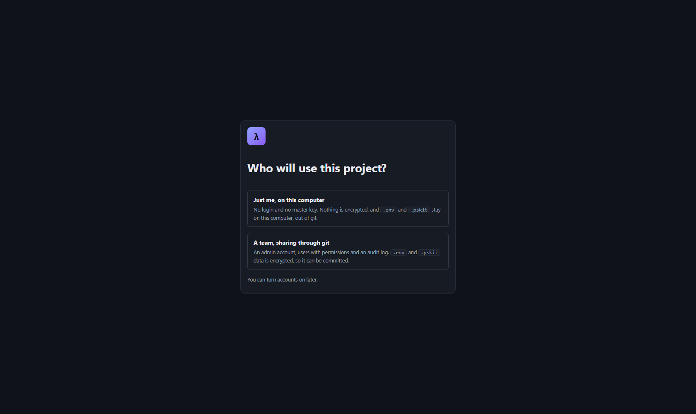
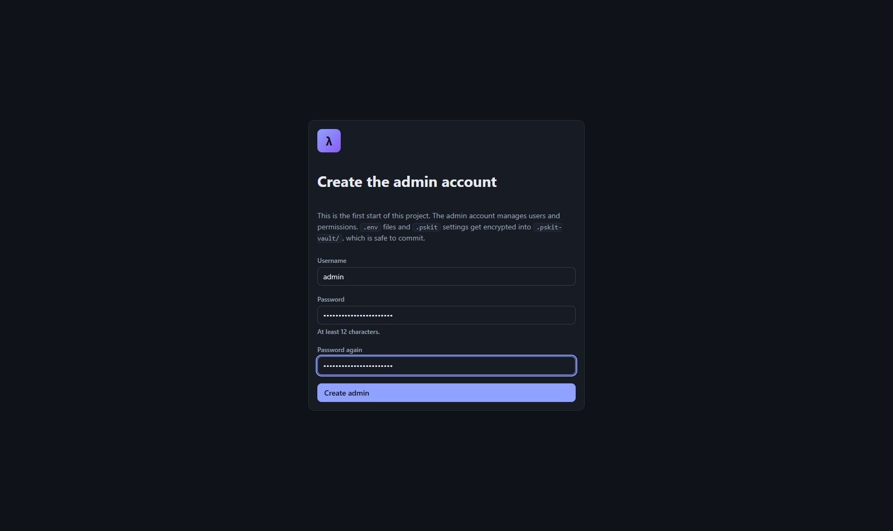
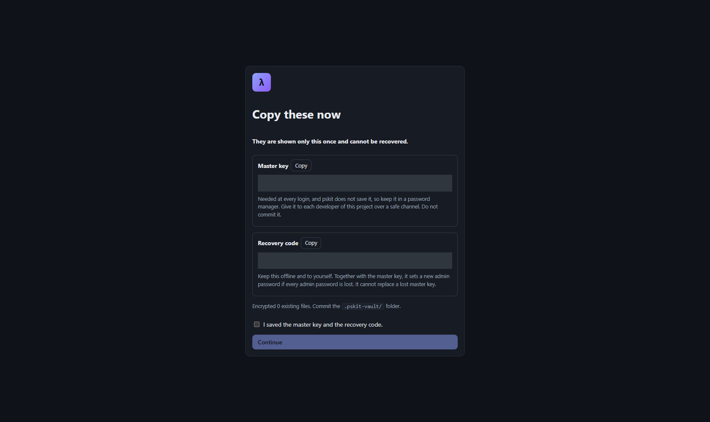
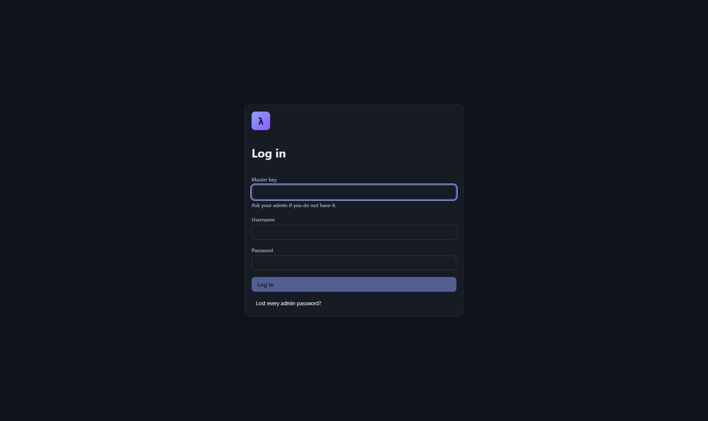
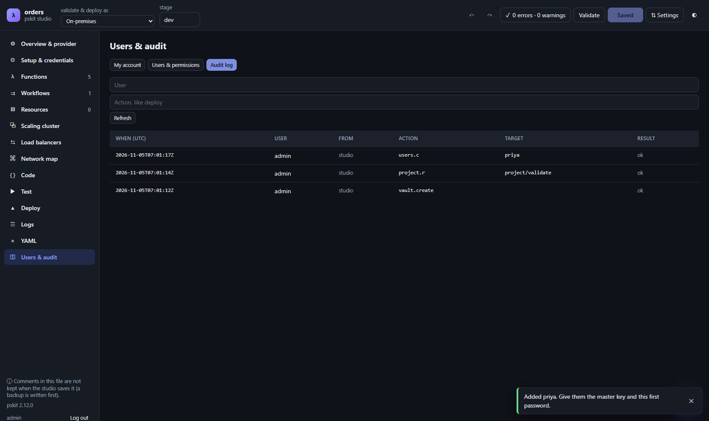
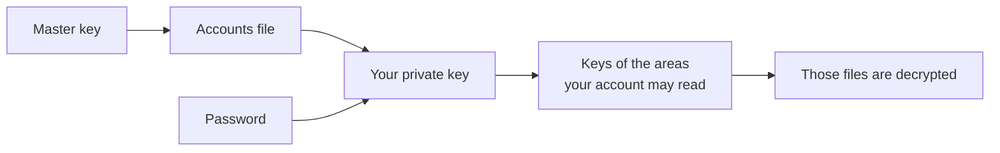
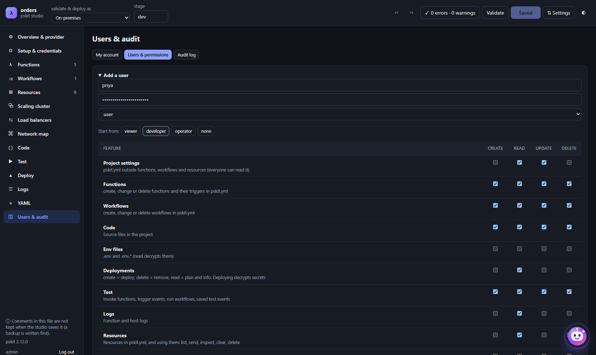

# Accounts and team setup in studio

Search terms: first start, just me, single user, team, admin account, master key, recovery code, recovery key, login, add user, user permissions, presets, viewer, developer, operator, create read update delete, crud, encryption, audit log, Users & audit, turn on accounts

This guide explains the choice `pskit studio` asks for at the first start, what the admin does, what the master key and
recovery code are for, how your data is protected, and how user permissions work. The exact file lists, encryption
details and limits are in [Accounts, encrypted project data and the audit log](../security-vault.md).

## The first start: just me or a team



The first time you run `pskit studio --open` in a project, it asks **Who will use this project?**

|  | **Just me, on this computer** | **A team, sharing through git** |
|---|---|---|
| Login | None | Master key, username and password |
| Master key and recovery code | None | Created once, at setup |
| `.env` and `.pskit` data | Plaintext on this computer | Encrypted into `.pskit-vault/`, which you commit |
| Sharing secrets with teammates | Not through git | Through git, encrypted |
| User permissions | None | Set per user and per feature |
| Audit log | None | Every change, refusal and login |
| `.gitignore` | Not changed. Check that it lists `.env` and `.pskit/` | `.pskit/`, `.env` and `.env.*` are added |

Choose **Just me** when only you work on the project. Choose **A team** when several people need the same secrets, or
when you want a login and a record of who did what.

Whichever you choose, the studio still needs the link it prints at start, and it listens only on this computer by default.

### Change your mind later

* **From just me to a team:** open **Users & audit > Turn on accounts**, then choose **A team** when studio asks again. Or run
  `pskit vault init`. Your existing secrets are encrypted at that point.
* **From a team to just me:** there is no switch. A project with a `.pskit-vault/` folder always needs a login, and
  `--no-auth` does not apply to it, so nobody can turn off a team's login by choosing this.
* **Just me is remembered in `.pskit/`.** If you delete that folder, studio asks again.

## Set up a team

### What the admin does





1. Run `pskit studio --open` and choose **A team, sharing through git**.
2. Fill in **Create the admin account**: a username and a password of at least 12 characters, then **Create admin**.
3. On **Copy these now**, copy the **Master key** and the **Recovery code** to a safe place. They are shown only this once.
   Tick **I saved the master key and the recovery code**, then **Continue**.
4. If studio warns that git already tracks a secret file, run `git rm --cached` on it and change that secret, because it
   is still in your git history.
5. Commit the encrypted data:

   ```bash
   git add .pskit-vault .gitignore
   git commit -m "chore: add encrypted project data"
   git push
   ```

6. Add each teammate as described in [Add a user](#add-a-user).

### What each teammate does



1. Get the master key and a first password from the admin, over a safe channel.
2. Clone the project and start studio:

   ```bash
   git clone <repo> && cd <repo>
   pskit studio --open
   ```

3. Enter the **Master key**, **Username** and **Password**, then **Log in**.
4. On **Choose your own password**, replace the admin's password. Nothing else works until this is done.

Only the data this account may read is decrypted. After a `git pull`, use **Users & audit > My account > Sync from
vault**, or run `pskit vault sync`.

## The admin account

An admin can do everything, and holds the keys to all encrypted data. Only an admin can:

* add, change, disable or remove accounts, and reset their passwords;
* set permissions;
* replace the master key and the recovery code.

A project can have several admins, and it must always keep at least one active. You cannot remove your own account, and
studio does not offer to disable it. Having two admins is a good safeguard against a lost password.

Only the `user` role has its access limited by permissions. Choose `admin` only for people who should see everything.

## The master key, the password and the recovery code

| | **Master key** (`pskm-...`) | **Your password** | **Recovery code** (`pskr-...`) |
|---|---|---|---|
| **Who has it** | Everyone on the team, the same key | Only you | Only the admin, kept offline |
| **What it does** | Opens the encrypted accounts file | Opens your private key, which opens the data your account may read | With the master key, sets a new password on an admin account |
| **When you need it** | At every login | At every login | Only if every admin password is lost |
| **Decrypts data by itself?** | No | No | No |
| **If it leaks** | Run `pskit vault rotate-master-key` and share the new key | Change it, or have an admin reset it | Run `pskit vault rotate-recovery-code`. The old code stops working |
| **If it is lost** | A logged-in admin can replace it. With no admin logged in, the data is gone | An admin resets it | An admin runs `pskit vault rotate-recovery-code` |

pskit does not keep the master key after you log out, so store it in a password manager. Never commit it or send it
through a chat that keeps history.

## How your data is protected



**In git.** `.pskit-vault/` holds only encrypted data, so anyone who can read the repository but has no master key sees
ciphertext. File names are hidden too. Your code is not encrypted, so that it stays reviewable.

**At login.** Each step needs the one before it:



So someone with only the master key, or only a username and password, gets nothing. Each kind of data (env files,
servers, services, clusters, deployments, studio data) has its own key, and an account receives only the keys it is
allowed. A developer with no read permission on Env files cannot decrypt them, even outside pskit.

In the studio, five failed logins lock that username for 30 seconds, and the wait doubles with each further failure, up
to one hour.

**While you work.** Secrets are decrypted to their normal paths, so `pskit deploy`, Terraform and SSH work as usual. Each
save in the studio is encrypted before the request returns, a check every 3 seconds catches what other programs write,
and CLI commands encrypt their changes when they end.

**When you stop.** Logging out, stopping the studio or the 12-hour limit encrypts your changes and removes the plaintext.
After a crash, the next start does this. Deleting `.pskit/` is not the same as logging out: see
[Logging in](../security-vault.md#logging-in).

**When someone leaves.** Remove the account, which gives the data it could read new keys, and replace the master key.
Then **change the real secrets**, because that person may have copies and old commits stay readable with the old keys.

**Everything is logged.** Changes, refused actions, logins (also failed ones), deploys and account changes are recorded
with the user, time, machine and target. Secret values never are. See **Users & audit > Audit log**.

## How user permissions work

A new user starts with nothing ticked and can only read `pskit.yml`. For each feature, the admin ticks any of **create**,
**read**, **update** and **delete**. The summary under the grid shows what the account can do.

### Add a user



1. Open **Users & audit > Users & permissions**, then **Add a user**.
2. Enter the username and a first password of at least 12 characters, and keep the role `user`.
3. Under **Start from**, click `viewer`, `developer`, `operator` or `none`, then adjust the ticks in the grid.
4. Click **Add user**.
5. Commit and push `.pskit-vault/`, then send the teammate the master key and first password.

In a terminal:

```bash
pskit vault users add priya --preset developer
pskit vault users set priya --allow code=crud --allow env=r --allow deploy=r
```

`--preset` and `--allow` on `users set` replace all of that account's permissions.

### The presets

C, R, U and D mean create, read, update and delete.

| Feature | `viewer` | `developer` | `operator` |
|---|---|---|---|
| Project settings | R | RU | RU |
| Functions, Workflows, Code | R | CRUD | CRUD |
| Env files | | | CRU |
| Deployments | | R | CRUD |
| Test | | CRUD | CRUD |
| Logs | R | R | R |
| Resources | R | R | CRUD |
| On-prem services, Servers, Clusters, Load balancers | | | CRUD |
| Network | | | R |
| **Can decrypt** | Nothing | Deployments, studio data | Everything |

Settings, Terminals & VS Code, Hana AI, Users and Audit log are in no preset. Tick them yourself if needed.

### What read means for secrets

Some ticks also control which data the account can decrypt:

| Permission | Lets the account decrypt |
|---|---|
| Read on Env files | `.env` files |
| Read on Servers | Saved servers and SSH keys |
| Read on On-prem services | Service settings and passwords |
| Read on Clusters or Load balancers | Cluster and load balancer settings |
| Read on Test or Hana AI | Saved test events and Hana settings |
| Read on Deployments | Deployment records, Terraform state and tokens |
| Create, update or delete on Deployments | **Everything**, because a deploy needs it |

Terraform state and tokens can hold secrets, so read on Deployments is not harmless. That is why `viewer` leaves it out,
so a viewer does not see plans or deployment info unless you tick it.

### Saving pskit.yml

A save is judged by what it changes: a new function needs create on **Functions**, a removed one delete, and a changed
one update. **Workflows** and **Resources** work the same way, and the rest of the file needs update on **Project
settings**. Editing `pskit.yml` as a file under **Code** counts the same.

### Permissions to give with care

* **Deployments (create, update, delete):** holds every key, and could ship code that prints secrets.
* **Terminals & VS Code, Hana AI:** full access. They reach everything the process can, whatever the grid says.
* **Update on Code:** can change handler code and files named by `extends`.

### Change or remove access

Open the user under **Users & permissions**:

* **Permissions**, then **Save permissions**: applies at once to sessions on that computer. Taking away read gives that
  data a new key and re-encrypts it.
* **Reset password:** the user must choose a new one at the next login.
* **Disable** or **Remove**: the account can no longer log in. Removing also gives the data it could read new keys.
* **Replace the master key:** every developer needs the new key.
* **Replace the recovery code:** the old code stops working and all encrypted data gets new keys. Teammates keep their
  passwords and the master key.

Commit and push `.pskit-vault/` after each change, because other computers see it only after they pull. All accounts are
in one file that git cannot merge, so push right away.

### What permissions cannot stop

Decryption is enforced by encryption. Every other permission is enforced by pskit on that person's own computer, so
someone who changes pskit's code can get around the create, update and delete rules locally. What actually protects
production is your cloud credentials and git branch protection. See
[What this protects against](../security-vault.md#what-this-protects-against-and-what-it-does-not).
