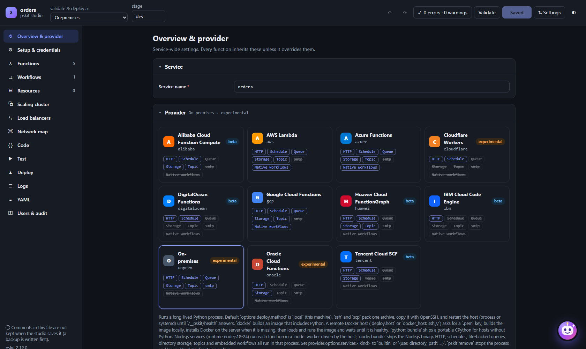
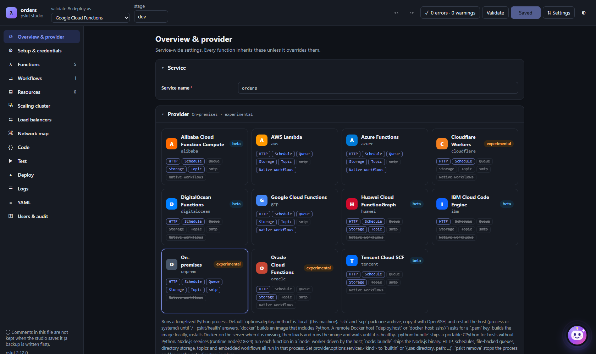

# Overview & provider page in studio

Search terms: overview, provider, switch provider, change cloud, region, runtime, memory, timeout, architecture, log retention, environment variables, tags, provider options, packaging, on-prem deployment, saved server, deploy method, host tuning

The **Overview & provider** page holds service-wide settings. Every function inherits them unless it overrides
them. Sidebar: **Overview & provider** (◎). Everything here edits the `service:`, `provider:`, `providers:` and
`package:` sections of `pskit.yml`.

## Rename the service in studio

The **Service** section has one field, **Service name** (`service:` in `pskit.yml`): 2 to 32 lowercase letters,
digits or dashes. Renaming a deployed service creates new cloud resources on the next deploy.

## Switch the provider in studio





The **Provider** section shows the same provider cards as the New project page (chips for HTTP, Schedule, Queue,
Storage, Topic, SMTP, Native workflows). The provider's notes appear under the cards.

1. Click another provider's card.
2. Studio opens **Switch to <Provider>?**:
   - If something will not run there, it lists "These won't run on <Provider>:" (up to 12 items) and offers
     **Switch & disable on <Provider>** and **Switch only (fix later)**.
   - If everything is supported, it says so and offers **Switch provider**.
3. **Switch & disable on <Provider>** writes `enabled: false` (or a reduced trigger list) only under
   `providers.<new provider>`, so the other clouds keep those triggers and workflows.
4. In both cases the old `provider.options` and `provider.region` move to `providers.<old provider>`, so switching back
   restores them. A runtime the new provider does not offer is cleared. Handler code does not change.
5. Validation, Deploy, Test and Logs follow the new provider. Press **Save**.

The written result, switching from AWS to GCP:

```yaml
provider:
  name: gcp
  region: us-central1
providers:
  aws:
    region: eu-west-1
    options: {}
```

From the terminal, edit `provider.name` in `pskit.yml`, or try another provider without editing it:
`pskit validate -p gcp`.

## Fix "providers.<cloud> overrides a setting" in studio

When `pskit.yml` has a `providers.<current provider>` block that overrides values shown on this page, a yellow box
says those values win when deploying and lists them. **Use the values shown here** moves them under `provider:`
(keeping settings only the override has). Save afterwards.

## Set defaults for every function in studio

The **Defaults for every function** section writes `provider.*` keys:

| Field | `pskit.yml` key | Notes |
|---|---|---|
| **Region** | `provider.region` | A list of the provider's regions, or free text; empty = provider default |
| **Stage** | `provider.stage` | `dev`, `test`, `staging`, `prod` or your own (lowercase, up to 16) |
| **Runtime** | `provider.runtime` | Python and Node.js versions the provider supports |
| **Memory (MB)** | `provider.memory` | 64 to 32768; default 256 MB |
| **Timeout (s)** | `provider.timeout` | Up to the provider's maximum (shown); default 30 s |
| **Architecture** | `provider.architecture` | `x86_64` (default) or `arm64` |
| **Log retention (days)** | `provider.log_retention_days` | Default 14 days |

Changing **Runtime** between Python and Node.js when functions exist asks **Switch the service to Node.js?** (or
Python): a service is either Python or Node.js; existing handlers stay as they are and new functions get stubs in
the new language.

## Set environment variables and tags for every function

The **Environment variables** section ("available to every function") edits `provider.environment` as key/value rows.
Names must match `[A-Za-z_][A-Za-z0-9_]*`. Use `${env:NAME}` for secrets instead of literal values. The **Tags**
section edits `provider.tags` (**Add tag**).

## Set provider options in studio

The **<Provider> options** section (hint `provider.options`) shows the provider's own options: for example the GCP
project, the Azure subscription, the Oracle compartment or the Cloudflare account id. Required options are marked.
Each provider's options are listed in [Providers](../providers/README.md).

## Change packaging and on-prem host settings in YAML

These settings have no form on this page. Edit them on the **YAML** page.

| Setting | Key | Default |
|---|---|---|
| Source directory | `package.source` | `.` (relative to `pskit.yml`) |
| Requirements file | `package.requirements` | `requirements.txt` |
| Exclude globs | `package.exclude` | e.g. `tests/**`, `*.md` |
| Vendor dependencies | `package.vendor` | provider decides; on = force `pip install` into the bundle, off = skip |
| Where the on-prem host runs | `provider.options.deploy` | this machine |
| Built-in queues, buckets and topics | `provider.options.services` | folders the host creates |
| Host tuning | `provider.options`: `execution_retention`, `workflow_workers`, `log_buffer`, `log_level`, `capture_output` | 500, 8, 5000, `INFO`, on |

To deploy a stage to a saved server every time:

```yaml
provider:
  name: onprem
  options:
    deploy:
      method: ssh
      server: app-1
```

For one deploy, pick the machine on **Deploy** -> **Run on** -> **Machine**, or run `pskit deploy --server app-1`. Save
servers under [Resources -> On-prem servers](servers.md). Details: [on-prem servers](../onprem/servers.md) and
[on-prem provider](../providers/onprem/README.md).

## See also

- [Setup & credentials](setup.md)
- [Providers](../providers/README.md) and [on-prem provider](../providers/onprem/README.md)
- [Function configuration](../functions/configuration.md)
- [Stages](../deployment/stages.md)
- [Placement](placement.md)
